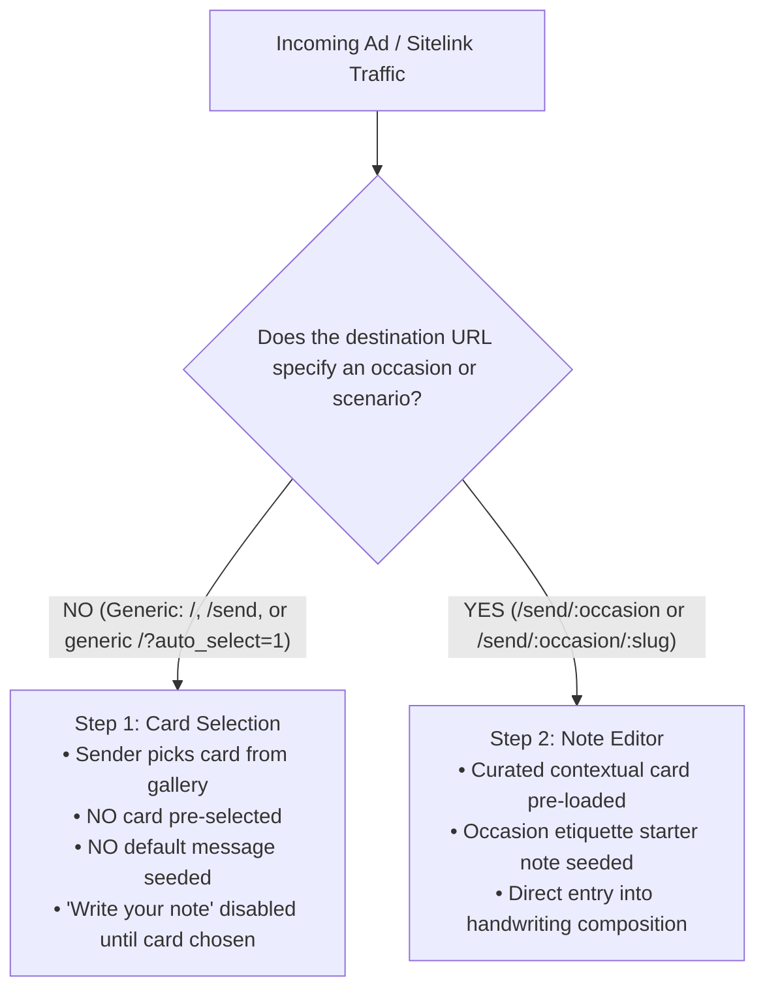

# Canonical Campaign URLs, Sitelinks, and Ad-Entry Specifications

**Document Version:** 1.0 (Canonical)  
**Effective Date:** October 16, 2026  
**Status:** Active Founder Decision & Engineering Standard  
**Applies To:** Google Ads, Meta Ads, Paid Social, Partner Placements, and Sitelink Extensions

---

## 1. Executive Summary & Core Rules

This document establishes the canonical specification for constructing and routing marketing campaign URLs, sitelink extensions, and ad destinations for SendMyNotes.

### The Two Core Entry Principles



1. **Generic Traffic Must Pick a Card (Step 1):**  
   When an ad or sitelink destination contains **no specific occasion or scenario context** (e.g. brand searches, general "real pen-and-ink cards" ads, or sitelinks pointing to the homepage or generic `/send`), the sender **must land on Step 1 (Card Selection)**.  
   - Do **NOT** automatically pick "A Quiet Cup" or any other design.
   - Do **NOT** seed a default message ("Just wanted to send a little piece of sunshine...").
   - Do **NOT** skip to Step 2 (Note Composition).
   - The action button ("Write your note") remains disabled until the sender explicitly selects a card.

2. **Contextual Traffic Enters the Note Editor (Step 2):**  
   When an ad or sitelink destination specifies an **occasion** (e.g., `/send/thank-you`, `/send/sympathy`, `/send/birthday`) or a **specific scenario** (e.g., `/send/sympathy/loss-of-pet`, `/send/anniversary/anniversary-cards-mailed`), the sender lands directly on **Step 2 (Note Composition)**.  
   - The curated card design for that occasion/scenario is attached (`draft.selectedDesign`).
   - The etiquette-crafted starter note for that occasion/scenario is pre-loaded.
   - The sender immediately sees live handwriting and can edit the message or tap to switch cards.

3. **Attribution Parameters Must Never Control Card Selection:**  
   UTM parameters (`utm_source`, `utm_medium`, `utm_campaign`, etc.) and click identifiers (`gclid`, `fbclid`, `gbraid`, `wbraid`) serve solely for telemetry and attribution. They must **never** independently select a card, seed a message, or bypass Step 1.

---

## 2. Active Sitelinks Breakdown (Configured in Google Ads)

The live Google Ads account currently uses four configured sitelinks:

| Configured Sitelink URL | Type | Target Route | Initial Step | Pre-Loaded Card Artwork | Pre-Loaded Note |
| :--- | :--- | :--- | :---: | :--- | :--- |
| `https://sendmynotes.com/?auto_select=1` | Generic Brand Sitelink | Redirects (307) to `/send?auto_select=1` | **Step 1** (Card) | *None* (Sender chooses from gallery) | *None* (Empty text area) |
| `https://sendmynotes.com/send/thank-you?auto_select=1` | Occasion Sitelink | `app/send/[occasion]/page.tsx` | **Step 2** (Note) | Wildflower Meadow (`/presets/thank-you-botanical.jpg`) | Curated Thank You etiquette template |
| `https://sendmynotes.com/send/sympathy?auto_select=1` | Occasion Sitelink | `app/send/[occasion]/page.tsx` | **Step 2** (Note) | Here for You Typography (`/presets/sympathy-typography.jpg`) | Curated Sympathy condolence template |
| `https://sendmynotes.com/send/birthday?auto_select=1` | Occasion Sitelink | `app/send/[occasion]/page.tsx` | **Step 2** (Note) | Make a Wish Birthday Cake (`/presets/birthday-cake.jpg`) | Curated Birthday celebratory template |

---

## 3. URL Construction Standards for Future Campaigns

### Category 1: Generic Brand & Value-Proposition Campaigns

Use for general keywords (e.g., *"real handwritten cards mailed"*, *"send handwritten letter online"*, *"no stamp card mailing service"*).

- **Recommended Canonical Sitelink / Ad URL:**  
  `https://sendmynotes.com/send`
- **Example with Full Google Ads Tracking:**  
  ```
  https://sendmynotes.com/send?utm_source=google&utm_medium=cpc&utm_campaign=brand_search&utm_term=handwritten+cards&utm_content=sitelink_send_card&gclid={gclid}
  ```
- **Legacy Compatibility:**  
  `https://sendmynotes.com/?auto_select=1` is fully supported and safely redirects to `/send?auto_select=1` while preserving all query parameters and click IDs. It lands on Step 1 with no card pre-selected.

---

### Category 2: Occasion-Specific Sitelinks & Ad Groups

Use for occasion-level keywords (e.g., *"thank you card real pen"*, *"sympathy cards mailed for you"*, *"birthday card service"*).

- **URL Pattern:**  
  `https://sendmynotes.com/send/{occasion}?auto_select=1`
- **Supported Occasion Slugs:**
  - `/send/thank-you?auto_select=1` → Pre-loads Thank You card & note
  - `/send/sympathy?auto_select=1` → Pre-loads Sympathy card & note
  - `/send/birthday?auto_select=1` → Pre-loads Birthday card & note
  - `/send/congratulations?auto_select=1` → Pre-loads Congratulations card & note
  - `/send/anniversary?auto_select=1` → Pre-loads Anniversary card & note
  - `/send/get-well?auto_select=1` → Pre-loads Get Well card & note
  - `/send/thinking-of-you?auto_select=1` → Pre-loads Thinking of You card & note
- **Example with Full Google Ads Tracking:**  
  ```
  https://sendmynotes.com/send/thank-you?auto_select=1&utm_source=google&utm_medium=cpc&utm_campaign=occasion_thankyou&utm_term=thank+you+notes+mailed&gclid={gclid}
  ```

---

### Category 3: Granular Scenario Deep Links

Use for high-intent, long-tail search queries where a specific emotional scenario is known.

- **URL Pattern:**  
  `https://sendmynotes.com/send/{occasion}/{scenario-slug}`
- **Active Pre-Rendered High-Converting Scenarios:**
  - Pet Sympathy: `/send/sympathy/loss-of-pet` (Pre-loads Rainbow Bridge artwork & pet loss note)
  - Anniversary to Spouse: `/send/anniversary/anniversary-cards-mailed` (Pre-loads Anniversary Floral & spouse note)
  - Job Promotion / Career: `/send/congratulations/promotion-and-congrats` (Pre-loads Modern Script & promotion note)
- **Example with Full Google Ads Tracking:**  
  ```
  https://sendmynotes.com/send/sympathy/loss-of-pet?utm_source=google&utm_medium=cpc&utm_campaign=scenario_pet_loss&gclid={gclid}
  ```

---

## 4. Paid Traffic vs. Organic Browsing Routing Matrix

| Route | Traffic Type | Query Parameters | Resolved View | Initial Step | Card Pre-Selected? |
| :--- | :--- | :--- | :--- | :---: | :---: |
| `/` | Organic | *None* | Studio on Homepage | Step 1 (`card`) | No |
| `/` | Paid / Legacy | `?auto_select=1` or `?utm_source=...` | Redirects to `/send` | Step 1 (`card`) | No |
| `/send` | Organic | *None* | Occasion Catalog Directory | N/A (Catalog) | N/A |
| `/send` | Paid / Legacy | `?auto_select=1` or `?utm_source=...` | Studio Full-Page View | Step 1 (`card`) | No |
| `/send/:occasion` | Organic | *None* | Occasion SEO Guide + Embedded Studio | Step 2 (`note`) | Yes (Occasion default) |
| `/send/:occasion` | Paid / Sitelink | `?auto_select=1` or `?utm_source=...` | Direct Studio | Step 2 (`note`) | Yes (Occasion default) |
| `/send/:occasion/:slug` | Organic | *None* | Scenario SEO Guide + Embedded Studio | Step 2 (`note`) | Yes (Scenario specific) |
| `/send/:occasion/:slug` | Paid / Deep Link | `?auto_select=1` or `?utm_source=...` | Direct Studio | Step 2 (`note`) | Yes (Scenario specific) |

---

## 5. Draft Restoration & Returning Visitors Protocol

To protect the user experience while ensuring compliance with entry rules:

1. **Fresh Visitors:**  
   Always arrive at the designated step (Step 1 for generic routes, Step 2 for contextual routes) with clean state.
2. **Returning Visitors with Default/Unedited Drafts:**  
   If a user previously opened the app but made **no custom edits** (`hasRealUserEdits === false`), a generic revisit will **not** restore the old template or override Step 1.
3. **Returning Visitors with Real In-Progress Edits:**  
   If a user typed a custom note or entered an address (`hasRealUserEdits === true`), their saved work is preserved and a gentle restoration toast is offered. Saved drafts are never arbitrarily wiped out.

---

## 6. Pre-Launch Verification Checklist for New Campaigns

Before activating any new ad creative or sitelink extension:

- [ ] **Destination Verification:** Is the URL pointing to `/send` (for generic) or `/send/{occasion}` (for occasion sitelinks)?
- [ ] **No Accidental Step Bypassing:** Confirm that generic visits land on Step 1 with no card selected and "Write your note" disabled.
- [ ] **Attribution Preservation:** Confirm that `utm_source`, `utm_medium`, `utm_campaign`, and `gclid` pass through any redirects intact.
- [ ] **Mobile & Desktop Viewport Testing:** Test at `390x844` (mobile) and `1440x900` (desktop) to ensure hydration matches server render.
- [ ] **Automated Regression Suite:** Run `npm run test:root-auto-select` and `npm run test:auto-select` before deploying.
