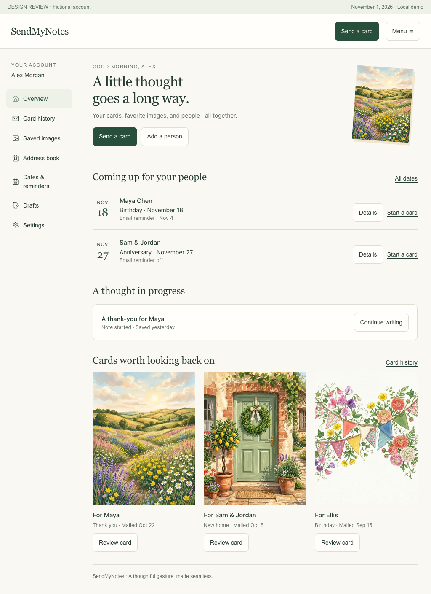
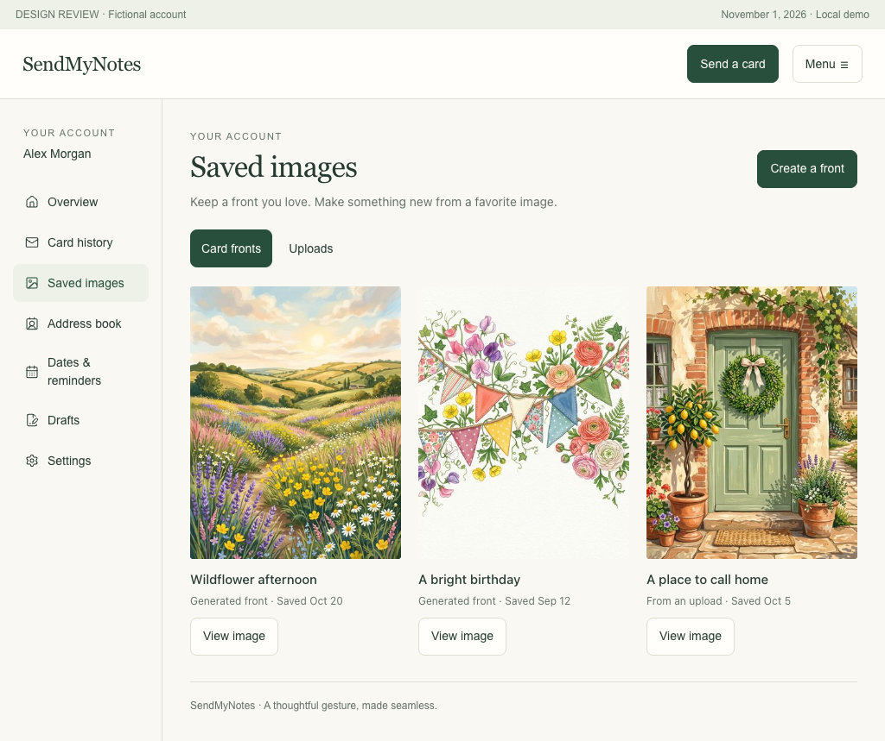
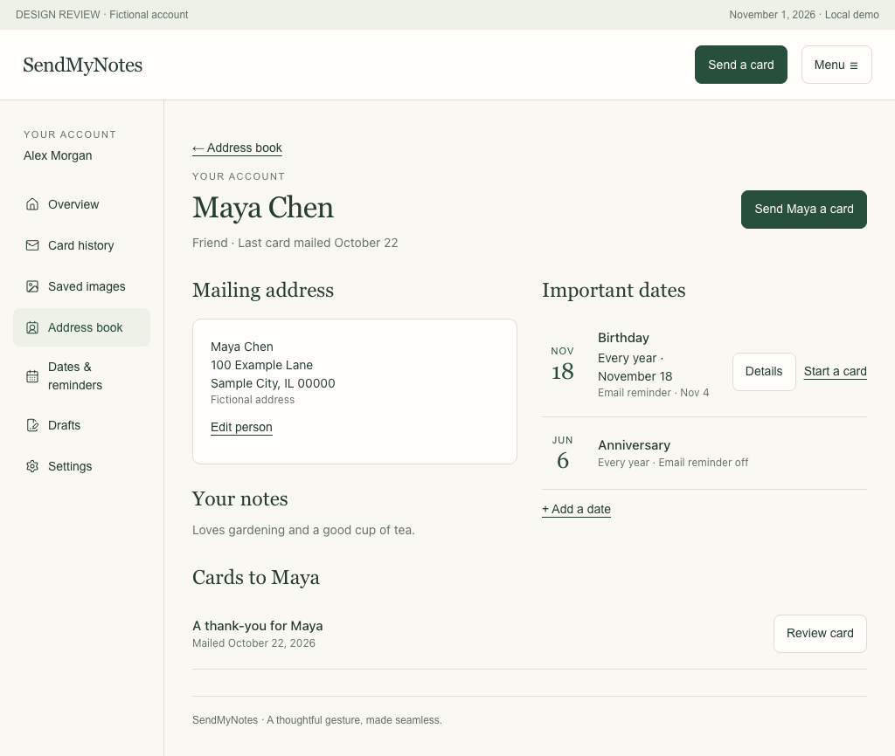

# Your SendMyNotes account

Design for review · November 1, 2026 · Proposed; not implemented or deployed

## Recommendation

Make **Account** a permanent entry in the signed-in main menu. Give it a calm, personal home: the people you care about, cards you have sent, images worth keeping, and occasions coming up. Avoid business-dashboard metrics or loyalty mechanics. Sending a card remains the primary action.

The account has six destinations: **Overview, Card history, Saved images, Address book, Dates & reminders, Settings**. Add **Drafts** when durable account saving is ready; until then offer an accurately labeled “Continue on this device” shortcut on Overview. This spec includes the intended Drafts screen so that the complete direction can be reviewed.

Generated fronts and uploaded source images belong in one **Saved images** library, with separate **Card fronts** and **Uploads** views. These are different things: a finished card front can start a card; a source image opens the Upload studio to make one. A saved image is not a sent card or a draft.

The requested two-week reminder becomes an explicit, per-occasion option: **“Email me 14 days before.”** Dates can be saved without enabling email. One person can have several dates, including a birthday and anniversary.

## Authority and scope

User-requested: a signed-in menu entry, reviewable sent-card history, optional saving/reuse of generated images, uploads, a first-class address book, personal dates and opt-in reminders approximately two weeks in advance. The additional pages and exact defaults below are recommendations for review.

The [canonical brief](../../CANONICAL_PROJECT_BRIEF.md) and [product specifications](../../CANONICAL_PRODUCT_SPECS.md) govern branding and product claims. Use SendMyNotes for the sender experience; preserve the personal return address. Fronts are 17:22, representing the selected 4.25 × 5.5-inch folded portrait format. Preview geometry is not a guarantee of exact physical trimming or handwriting wrapping. No adoption, conversion, delivery, or time-saving results are claimed.

This is a design and build specification, not sprint execution. Mockups use fictional people, example dates as of November 1, 2026, and existing catalog illustrations as stand-ins for private artwork. No customer data, live emails, payments, or fulfillment are involved.

## What already exists

Repository inspection establishes the following implementation facts, not live deployment verification:

| Area | Current evidence | Required change |
| --- | --- | --- |
| Account | [Account page](../../../app/account/page.tsx) has Order History and Address Book tabs, return-address editing, import, and upcoming dates. | Split into navigable routes with shared chrome, clear empty/error states, and mobile navigation. |
| Discoverability | Account links exist in [legacy builder](../../../components/VendingMachineBuilder.tsx) and [order page](../../../app/order/[id]/page.tsx). `/new` uses [entry client](../../../app/preview/entry/client.tsx) and [FlowHeader](../../../components/flow/FlowHeader.tsx), whose inspected source has no account menu. | Expose Account and Address book in the main signed-in menu across active entry flows. Validate deployed routing during implementation. |
| History loading | Account page's direct GET omits Authorization, while [account API](../../../app/api/account/route.ts) requires a bearer token. [AuthContext](../../../context/AuthContext.tsx) sends the token correctly for its own fetch. | Share an authenticated data layer. A failed request must not render “No cards sent yet.” |
| History review | Existing tiles show a cover and short note excerpt. “Send Again” links to `/` without copying the card. Status presentation collapses many states into a generic queue label. | Add immutable order detail, honest statuses, and a deliberate copy-to-draft action. |
| Address book | `savedAddresses` is an account array. Each address has one optional occasion; import and return-address controls exist. | Stable contact IDs, multiple occasions, contact-first organization, independent address completeness. |
| Reminders | [types](../../../lib/types.ts), [storage](../../../lib/reminders.ts), [API](../../../app/api/reminders/route.ts), and [email function](../../../lib/email-alerts.ts) exist. Repository references show the queue/email helpers used in tests; no production dispatcher was found in inspected source. | Build and verify an authenticated scheduler/outbox workflow before claiming reminders work. Existing email code alone is not delivery evidence. |
| Reminder consistency | Contact saves POST a fresh reminder without a stable reminder ID. Unchecking the contact checkbox does not visibly revoke an existing reminder; new reminder POST forces opt-in true. Contact modal defaults remindMe true. | Explicit opt-in off by default for new occasions; one occasion source of truth; edit/delete/pause reconciled atomically. |
| Saved artwork | `UserAccount.savedCovers: string[]` exists and is preserved by account writes. No functional personal-library CRUD/view was found in inspected code. | Owned asset records, durable storage, explicit saving and reuse; do not assume the string array is a finished library. |
| Drafts | [Draft model](../../../lib/draft/types.ts) specifies a device draft with 24-hour expiry. | Account drafts require new persistence and conflict handling; do not label device data “saved to your account.” |
| Uploads | [October 30 Upload studio design](../2026-10-30-upload-card-front/DESIGN_SPEC.md) proposes a separate, initially account-entitled workflow. Matching upload routes were not found in this checkout. | Integrate the library with that design. Verify actual deployed implementation before reusing any contracts. |

## Navigation and page structure

Signed-in main menu: **Send a card**, **Account**, **Address book**, **Help**, **Sign out**. Account opens Overview; Address book is a direct shortcut. Within the account, desktop uses a left sidebar; mobile uses a labeled **Account pages** disclosure listing every destination vertically, with the current page indicated. Avoid seven horizontally scrolling tabs. Browser Back, refresh, and copied deep links must preserve the page/filter.

Signed-out menu offers Sign in and Send a card. Direct account links show a sign-in gate and return to the requested internal route afterward. Expired authentication preserves unsaved local edits while asking for sign-in; never briefly show the previous account's data when switching users. Guest card sending remains available.

| Page / proposed route | Purpose and primary action |
| --- | --- |
| Overview · `/account` | Next dates, a resumable draft, and a few recent cards. **Send a card**. No arbitrary KPI counters. |
| Card history · `/account/history` | All paid/accepted orders, with **All / In progress / Mailed / Needs attention** filters and search by recipient. **Review card**. Unpaid attempts remain drafts, not sent cards. |
| Card detail · `/account/history/[orderId]` | Read the front, exact saved note, handwriting selection, recipient/return snapshot, and payment/status detail. **Make a similar card**. |
| Saved images · `/account/images` | **Card fronts / Uploads**; image detail at `/account/images/[assetId]`. **Create a front** or **Upload image**, as authorized. |
| Address book · `/account/people` | Search people; **Add person**. Detail `/account/people/[contactId]` includes addresses, dates, notes and related cards. |
| Dates & reminders · `/account/dates` | Upcoming agenda across people, with reminder controls; **Add a date**. A calendar grid is unnecessary for v1. |
| Drafts · `/account/drafts` | Resume, rename, duplicate or delete saved cards. Ship only with durable account saving. |
| Settings · `/account/settings` | Profile/sign-in, default return address, email preferences, time zone, privacy and account controls. |

Keep receipts in each card detail, not a separate Billing section. Help is a persistent utility link, with an order-specific help action in history detail. Defer payment-method management, subscriptions, credits/rewards, bulk campaigns, and a separate analytics page until the product actually needs them.

## Screen and interaction specification

### Overview

Heading: **“A little thought goes a long way.”** Supporting line: “Your cards, favorite images, and people—all together.” Show up to three upcoming occasions with name, occasion, full date, and reminder state. “Start a card” carries the linked contact and occasion into a new draft. If an occasion already has an associated paid card, show “Card ordered” with a review link; never infer that matching a recipient means the occasion is handled.

Below, show one recent draft and up to three recent cards. New-account state: **“Make room for the people you care about.”** Offer Add a person and Send your first card. Do not fabricate activity or populate sample contacts in production.

### Card history and review

Use generous portrait thumbnails, recipient names, occasion/title when known, order date and actual status. The dominant link is Review card. Never label all paid orders “sent” while some are still preparing. Filter counts, if shown, must describe the actual filtered data set; use server cursor pagination, 20 records at a time, not a full-account scan.

Detail has **Front / Inside / Envelope** preview tabs. Front displays the frozen image rendition accepted for that order. Inside shows the exact saved greeting/note/sign-off in the selected style with an accessible plain-text view. Envelope shows the order-time addresses, clearly marked “Address details” when no verified envelope rendering exists. All views are representations, not photos of the mailed item.

Show payment total/currency, discounts/refund state, receipt access when available, order reference, and status timeline from recorded events. Keep unavailable timestamps absent; label missing legacy data “Not available for this older card.” A missing front must not prevent note/receipt review. Do not regenerate historical artwork from a prompt.

| Internal state | Customer presentation |
| --- | --- |
| `PAYMENT_RECEIVED`, `QUEUED_FOR_FULFILLMENT` | Order received / Preparing, based on available event evidence. |
| `AWAITING_RECIPIENT_ADDRESS` | Address needed, with secure address-completion action. |
| `DISPATCHING`, `PROCESSING_HANDWRYTTEN` | Preparing your card. |
| `DISPATCH_UNCERTAIN` | We're checking your order. Suppress duplicate checkout/retry prompts. |
| `MAILED` | Mailed, with timestamp only when recorded. Never infer Delivered. |
| `FAILED`, `PAYMENT_VERIFICATION_FAILED` | Needs attention, with a specific next step and payment state. |
| Future scheduled send | Show schedule as a separate attribute only for an accepted valid schedule; preserve actual order state. |

**Make a similar card** creates a new editable draft with the chosen front and a proposed copy of the note/style. Ask whether to keep or change the recipient; recheck saved addresses. Drop the old send date, payment identifiers, offer/quote and acceptance flags. Require current review and checkout. This action never sends or charges. If a draft already exists, offer Keep existing draft or Start a separate card; no silent overwrite.

### Saved images and uploads

Fronts: thumbnail at 17:22, editable title, Created/Uploaded-derived label, saved date, and **Use this front**. Detail exposes Rename, Remove from library, and the prompt when present through a secondary disclosure. Front reuse uses the stored output without a new generation request. **Make a variation** explicitly opens generation and displays any applicable allowance before submission.

In the generation result view, add **Save to my images** as an optional action. Success appears only after durable storage and metadata commit; repeat clicks are idempotent. Signed-out users may sign in to save while retaining the current result. They can continue sending without creating an account. Do not silently save every generated attempt to the library. Order history retains its own required artwork snapshot regardless of library membership.

Uploads view keeps original aspect ratios with containment, not misleading portrait crops. Cards say **Source image** and **Make a card front**, never “Ready to mail.” The source is input to the October 30 studio composition flow; this design does not introduce a direct photo-printing bypass. Result saving is a separate choice, and users can save a source for later without generating immediately.

Adopt the earlier proposed validation defaults: JPEG, PNG, WebP; one image per upload; 15 MB maximum. Decode server-side, reject corrupt/animated/disallowed files, bound decoded dimensions/pixels, normalize orientation, strip metadata, and preserve an authorized private source representation. Verify exact size/pixel and account storage quotas before release; show remaining capacity when near the configured limit. A duplicate upload offers the existing source rather than consuming storage again.

State progression: Select → Validating/uploading → Saved source → Make a card front → Review composed front → Save front and/or Use this front. Failed uploads preserve the user's context and give a specific retry action. No front becomes usable until the authoritative print master is complete and accepted. Preview, draft and order refer to that exact version.

**Upload access recommendation:** keep the October 30 invite entitlement for the initial launch, expose Uploads/Upload image to eligible accounts, and place future broad rollout behind one server capability. This request establishes account placement; whether to expand eligibility to every signed-in account is a review decision. The mockup shows an eligible account. A revoked/expired account may inspect/remove existing assets but cannot create or newly use restricted upload-derived fronts; paid orders keep their snapshots and proceed. Ordinary generated fronts remain reusable subject to their own rules.

Removing an image from the library never corrupts an existing paid order. If a draft references it, explain the dependency and retain the draft rendition until that draft is changed/deleted. Distinguish **Remove from library** from a privacy deletion request. Use private storage and short-lived authorized delivery; never place sources, prompts, or personal images in public paths or analytics.

### Address book

Use **Address book** as the recognizable navigation label; page heading **“Your people.”** A person is more than an address. Minimum save requirement is a display name. Optional fields: preferred name, relationship/label, private note, mailing name and address. No contact email or phone is required to mail a card. One primary mailing address is enough for v1; structure storage for additional addresses later.

Allow name + birthday with no postal address. Show **Address needed** and collect/verify it before checkout. Never block saving a meaningful date because the street is unknown. Keep notes modest and private, e.g. “Loves gardening”; do not insert them automatically into card wording.

Person detail groups **Mailing address**, **Important dates**, **Your notes**, **Cards to this person**. Each date has its own edit/delete and reminder toggle. “Send a card” starts a draft with the selected contact ID and a snapshot of the current address. If the contact changes afterward, offer updating the draft at review; never rewrite a paid order.

Add “Choose from address book” at recipient entry in the active builder and an unchecked “Save this person” option after entering a new recipient. Review proposed updates to an existing person rather than silently merging by first name/street. Import remains a secondary action: preview parsed contacts and dates, highlight duplicates/invalid fields, choose create/update/skip, then report partial failures. Import never enables reminders without an explicit choice covering the selected occasions.

Deleting a person explains that their future reminders stop; past cards remain in history. Remove or tombstone linked occasions and cancel pending jobs in the same logical operation. An anniversary can attach to one named person/household; shared multi-person event linking is deferred.

### Dates & reminders

An upcoming list grouped by month works better than an empty calendar grid. Each row shows the person, occasion, next occurrence date, reminder state/next email date, and Start a card. Include **All / Email reminders on** and a past/sent reminder disclosure only if useful; do not turn this into a campaign tool.

Date editor: person, Birthday/Anniversary/Other, optional title, month/day, optional original year, and **Repeats every year**. Birthday and anniversary default to annual; Other can be annual or once. One-off dates require a full year. Validate real dates (no April 31); a birth/anniversary year supports optional milestone text, not routing logic.

New event reminder checkbox starts **off**. Label **“Email me 14 days before.”** Beneath it: “Sent to alex@example.com. You choose whether and when to send a card.” Use the verified account email; do not email the recipient. A global pause in Settings overrides event toggles without erasing them, and the event visibly says “Paused in settings.” Email changes require verification before reminder delivery resumes to the new destination.

Proposed dispatch policy: 9 a.m. in the account's confirmed IANA time zone, 14 calendar days before the occurrence. Display the concrete next reminder date/time and time zone when enabled. This is a reminder time, not an arrival promise. Time-zone changes recalculate pending occurrences; use calendar-day arithmetic across DST and year boundaries.

If the occasion is fewer than 14 days away, say **“This date is less than two weeks away. Email a reminder tomorrow?”** as a separate opt-in choice. If today is the occasion, show it in the agenda and offer Start a card; do not enqueue a stale tomorrow reminder. Past one-off events get no send. Annual events roll forward. For February 29, default to February 28 in non-leap years and display the rule; allow March 1 in the date editor. No silent JavaScript date rollover.

One reminder per event occurrence. Scheduler retries must not produce repeat emails; use a transactional outbox, stable occurrence idempotency key, delivery attempt log and provider deduplication where supported. Recheck consent, account/email verification and event version immediately before sending. Deleting, pausing or changing an event cancels stale queued work. Retrying an uncertain provider response must reconcile rather than blindly resend. A provider-accepted email is “Sent,” not proof of inbox delivery.

Proposed outage policy: catch up an opted-in missed job within 48 hours of its due time while the event is still in the future, once; mark older jobs missed and show them in the account. Do not send weeks of accumulated messages after an outage. If a card is explicitly linked to that event occurrence and payment is accepted, suppress its still-pending reminder by default; canceled/failed cards restore eligibility only under the same deadline rules. Do not suppress by recipient name alone.

Example email: subject **“Maya's birthday is in two weeks.”** Body: “Maya's birthday is November 18. A little note can make it feel special.” CTA **Start a birthday card**; secondary Manage this date and Stop occasion reminders. No full postal address or saved private note appears in email. CTA uses an opaque link, signs the user in if needed, and seeds the contact/occasion after ownership validation. It never sends a card automatically. Use actual days remaining for catch-up email copy.

Unsubscribe disables only optional occasion reminders, not necessary order updates. Signed unsubscribe links perform no state change on a scanner's GET; show a minimal confirmation form and apply the opt-out on POST without requiring login. Disable already queued optional reminders promptly.

### Drafts and Settings

Drafts show recipient/title, front, last saved time, progress, and Continue. Clear “Saving…”, “Saved”, “Couldn't save—retry” states distinguish persistence from local edits. Account drafts work across devices; sign-in presents a deliberate import of the current guest draft, with no automatic overwrite. Proposed retention is 90 days of inactivity, displayed before saving and before expiry; confirm the final retention policy before release. A concurrently changed draft offers reload/copy recovery using version checks.

Settings sections: **Your profile** (name and sign-in method); **Return address** (default personal sender identity, validated when used); **Emails & time zone** (verified destination, per-account pause, link to individual dates); **Privacy & account** (data export request, deletion request, sign out). Explain actual deletion/retention behavior before confirmation. Keep ordinary order updates separate from optional reminders. Do not invent stored cards, balances or password controls for Google-only accounts.

## Shared states, visual design and accessibility

Warm paper backgrounds, dark green primary actions, serif page headings, restrained rules, large artwork, and plain sans-serif controls continue the current personal stationery direction. Use generous space without pushing primary actions below a full-screen banner. Account pages should feel like a personal collection, not an admin console.

Desktop: approximately 200px sidebar plus flexible content. Mobile: one column, labeled collapsible navigation, full-page detail/edit views instead of tiny drawers; action rows wrap. Maintain 44px touch targets and visible keyboard focus. Label inputs; use real buttons/links; provide text equivalents for image/handwriting content. Selected navigation and status must have text/shape cues beyond color.

Loading uses skeletons that do not mimic real records. Empty states explain what to do. Network/auth failures have a retry/sign-in action and must not erase edits or masquerade as empty collections. Pagination errors retain loaded content. Save errors retain input and expose what was not saved. Delete confirmations name the item and consequences. Restore focus after dialogs; Escape closes non-destructive overlays; preserve browser Back and reasonable scroll restoration. Verify 320, 390, 768 and 1024px widths, keyboard-only navigation, zoom/reflow and light/dark contrast.

## Build architecture

Reuse Firebase identity, existing order records and transactional email infrastructure after verifying their contracts. Derive ownership exclusively from verified authentication, not query/body UID or email. Make all account creates/reads/updates/deletes authenticated and validate ownership of linked records. The existing reminder API's unauthenticated create path must not become the account reminder write path. Legacy email ownership must require verified email before claiming or exposing records.

| Proposed entity | Essential fields and invariants |
| --- | --- |
| Account preferences | UID, display name, default return address, verified reminder destination, confirmed time zone, global reminder pause, versions/timestamps. |
| Contact | Owner UID, stable ID, display/mailing names, relationship, optional address, private note, version, soft-deletion marker. |
| Occasion | Owner/contact IDs, type/title, month/day, optional original year or one-off year, recurrence, leap-day policy, opt-in, leadDays=14, consent timestamp/source, version. |
| Reminder occurrence / outbox | Owner + event + occurrence date + channel unique key, event version, dueAt, state, attempts, provider ID, acceptedAt. Keep deduplication stable across date edits that revert to the same occurrence. |
| Image asset / version | Owner, kind (`generated_front`, `uploaded_source`, `upload_front`), source link, durable object references, preview/master dimensions, content hash, title, private prompt metadata, capability requirements, saved/deleted timestamps. Final renditions immutable. |
| Draft | Owner, ID/version, asset/version, note/style, contact/occasion reference, recipient/return snapshots, progress, updatedAt/expiresAt. No payment secrets, raw card details or order access tokens. |
| Order snapshot | Existing order identity plus frozen artwork/note/style/addresses, trusted payment/fulfillment events and optional event occurrence link. Never render historical content from mutable contacts. |

Prefer per-owner subcollections for contacts, occasions, images and drafts rather than growing arrays or concurrent whole-account replacement. Server endpoints provide bounded pagination/filtering, structured validation errors, idempotent create/save, and optimistic concurrency on edits. Proposed route families: `/api/account/people`, `/occasions`, `/images`, `/drafts`, `/preferences`, plus `/api/account/history` and owner-checked detail. Exact framework organization is an implementation choice.

Generation saves should authorize a server-created result ID, not let clients submit arbitrary external URLs for fetching. Image upload flow validates capability and quotas before granting a short-lived upload intent; finalize only owned decoded media. Server enforces reuse rules at acceptance and checkout. Front preview and fulfillment must resolve the same immutable rendition.

Keep the existing secure guest order-detail mechanism compatible; account history should use UID authorization and must not expose or persist guest bearer tokens in account URLs. Guest order association requires verified account-email ownership plus the existing order access rules, never a typed email alone.

Migration is repeatable: map saved-address IDs into contacts; map one embedded occasion into a stable event; preserve saved return address. Inventory standalone reminders and reconcile only deterministic owner/contact/date matches; ambiguous duplicates need review. Preserve existing explicit consent where demonstrable; an old default-true checkbox is not evidence of a new intentional opt-in. Leave uncertain consent paused with clear account copy. Do not send migration backfill email. Preserve old records until migration checks pass.

Treat existing `savedCovers` URLs as candidates only: validate owner/provenance and durable availability before importing. Preserve order snapshots independently. Store a migration version and counts; use feature flags and staged read cutover so rollback does not discard new writes. Once per-record writes launch, retire stale full-array writes or bridge them with version guards to prevent data loss.

## Delivery sequence and acceptance gates

1. **Account foundation and history:** shared signed-in menu, account shell, authenticated loading, pagination, status mapping, read-only detail, Settings return address. Gate: owner isolation, deep-link auth return, correct error vs empty, old-card fallback, immutable order review.
2. **People and dates:** contact migration, contact detail/import, multiple occasions, builder picker and saved-contact updates. Gate: same person with birthday + anniversary, missing postal address allowed, edit/delete consistency, import duplicates and partial failures, no paid-order mutation.
3. **Saved images and Upload studio integration:** explicit save, durable assets, generated reuse, source uploads and composition handoff, removal/dependency behavior. Gate: cross-account asset denial, format/size validation, revoked access, failed save recovery, no regeneration on reuse, 17:22 preview/master consistency.
4. **Reliable reminders:** scheduler, outbox, verified destination, opt-in/stop controls, operational failure visibility. Gate: clock-controlled tests for 14 days, year rollover, leap day, DST, catch-up, duplicate runs, pause/delete/edit races and provider uncertainty. Use a fake email transport first; verify a consented test inbox before enabling delivery. Feature stays labeled unavailable until dispatch is verified.
5. **Durable Drafts:** versioned multi-device saving, guest import, retention messaging, handoff from history/library/contact/date. Gate: concurrent edits recover safely; quotes/payment state reset; starting any draft never creates a billable order.

Each slice includes mobile/accessibility validation and account-bound authorization checks. Reminder dispatch and supplier fulfillment tests remain isolated; never run billable fulfillment scripts as an audit. Verify mail-provider configuration and scheduler deployment separately from repository tests.

Analytics, if added, capture opaque IDs and actions only: account opened, contact saved, date saved, reminder opted in/paused, asset saved/reused, history copied, draft resumed, and subsequent independent paid order. Exclude private names, dates, notes, addresses, images and prompts. Separate founder testing and comps. These events are instrumentation proposals, not forecasts.

## Review decisions

Recommended defaults for review: one library with Card fronts/Uploads; agenda-style Dates & reminders; 14 days at 9 a.m. account time; reminder opt-in initially off; preserve invited upload rollout until deliberately expanded; add Settings now and durable Drafts as a separate build slice. No further decision is required to review the design.

The interactive mockup covers overview, menu, history/detail, library/source upload, people/detail/editor, dates/reminder/email, drafts and settings. Controls are local demonstrations; it does not connect to an account, accept real uploads, send email or place orders. See [mockup source](assets/account-review.html) and [visual review evidence](assets/review-checks.json). Screenshots are saved beside the mockup after visual QA.

## Mockups for review

### Account overview and navigation

[Phone overview](assets/overview-390.png) · [Signed-in main menu](assets/menu-1024.png) · [Card history](assets/history-1024.png) · [Saved inside message](assets/inside-1024.png)

### Saved images

[Phone library](assets/images-390.png) · [Uploaded sources](assets/uploads-1024.png)

### People, occasions and settings

[Phone person detail](assets/person-390.png) · [Address book](assets/people-1024.png) · [Phone reminder editor](assets/event-390.png) · [Desktop reminder editor](assets/event-1024.png) · [Settings](assets/settings-1024.png)

### Review validation and limits

The local browser check covered 15 screens at 320, 390, 768 and 1024 CSS pixels in light and dark appearance: 120 combinations, with no horizontal overflow, missing images or JavaScript page errors detected. Interaction checks cover menu/address-book entry, search, historical inside preview, reminder toggling and new-event default-off, global pause, sample uploads and mobile navigation. Desktop overview/library and phone overview/person/reminder screenshots were visually inspected.

The mockup illustrates the main flow using a small set of fixtures: several example records share the same detail screen, editing dates is limited to the illustrated November 18 occurrence, and secondary actions describe the intended handoff. It is not a complete working account application. The spec, rather than fixture behavior, defines actual CRUD, calendar validation, privacy controls and storage. No production service behavior was validated by these checks.
