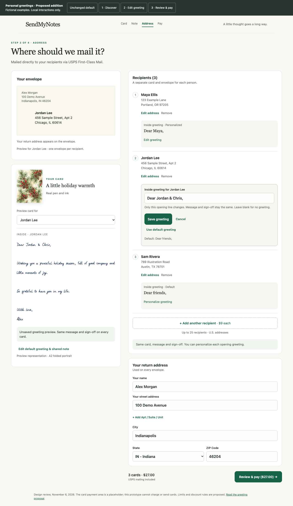
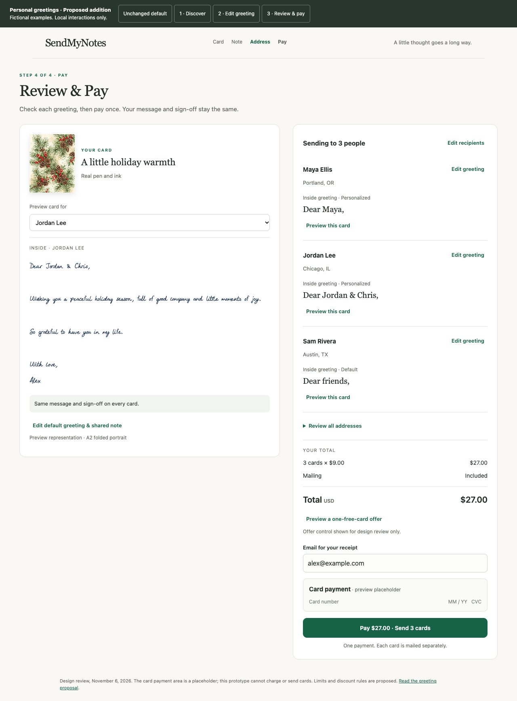

# Personal greetings in multi-send

November 6, 2026 · Approved for inclusion in Sprint 0028 by the founder; planning only, implementation not started.

[Interactive mockups](assets/personal-greetings.html) · [Base design](DESIGN_SPEC.md) · [Sprint 0028](../../sprints/SPRINT-0028.md)

## Recommendation

Add an optional greeting override to each recipient, edited in the Address step after the sender has opted into multi-send. Keep the cover, message, sign-off, handwriting and return address shared. This gives a personal sender a useful distinction—“Dear Maya,” versus “Dear Jordan & Chris,”—without asking them to compose separate cards.

Implement this within Sprint 0028 after establishing the base multi-send contracts. Recipient-level state is part of W1, inline editing W2, payment review and validation W3, and frozen dispatch/recovery W4–W5; G1–G5 are required acceptance checks. A staged base-only release may be considered if timing requires, but does not complete the approved greeting scope. No credible duration estimate exists until the base implementation and its tests have been inspected.

The founder explicitly approved integrating this design into the sprint on November 6, 2026. It supersedes the original “same greeting on every card” scope. No full message personalization, merge tags, inferred first names, AI rewriting, bulk greeting editor or new checkout step.

## Placement and flow

1. **One-card default:** no greeting feature appears on the current Address screen. The existing Note step remains the place to compose the single card. The only multi-send entry remains “+ Add another recipient.”
2. **After opting in:** every saved recipient row displays `Inside greeting · Default`, its exact text, and a quiet **Personalize greeting** action. The address editor remains about addresses. Save a new recipient before customizing their greeting; do not add another required field to the address form.
3. **Edit in place:** that action expands one text field immediately below the selected address. Label it “Inside greeting for Jordan Lee.” Initialize it with the effective greeting, exactly as written. Explain: “Only this opening line changes. Message and sign-off stay the same. Leave blank for no greeting.” Provide **Save greeting**, **Cancel**, and **Use default greeting**. No modal or extra step.
4. **Preview:** select that person's complete card automatically. Desktop retains preview left / recipient editor right. Typing updates the opening line in the preview; the body and sign-off remain visible and unchanged. A “Preview card for” selector permits checking other recipients. On mobile, keep the input inline and focus above the fixed action bar; a sender can scroll to the preview. The preview clearly labels unsaved text.
5. **Saved state:** the row shows the exact opening line, `Personalized`, and **Edit greeting**. Default is a relationship, not a copied string: later shared-greeting edits update inherited greetings only. “Use default greeting” immediately resets this recipient to inheritance; the default text is shown beside that action before using it. Cancel discards unsaved edits.
6. **Review & pay:** show every recipient's exact greeting beside their name and city, including inherited greetings and explicit “No greeting.” Do not hide these behind the full-address disclosure. **Preview this card** selects the complete note; **Edit greeting** returns to that recipient's inline editor on Address. After saving, the existing Review & pay action returns to checkout. Quantity and price stay unchanged; checkout content verification still runs again.

Example reviewed order:

| Envelope addressee | Inside greeting | Source |
| --- | --- | --- |
| Maya Ellis | Dear Maya, | Personalized |
| Jordan Lee | Dear Jordan & Chris, | Personalized |
| Sam Rivera | Dear friends, | Default |

Envelope identity and inside greeting are independent. A card addressed to one household member can greet two people. Never derive a greeting by splitting an address-book name: household names, nicknames and preferred salutations make that unreliable.

## Preserve the sender's intent

- Preserve the Note step's original greeting when multi-send opens, even if it says “Dear Maya,”. Surface its exact text for each recipient. Do not silently replace it with a generic greeting or claim to have detected every personal name. The mockup's discovery scene deliberately starts with “Dear friends,” to demonstrate inheritance; production must retain whatever the sender wrote.
- Name the shared field **Default greeting** once multi-send is active. Explain that personalized greetings stay unchanged. Message and sign-off continue as separate shared fields.
- Only one recipient or shared-note editor is open at a time. Save or cancel before opening another editor, deleting a recipient, moving to payment or paying. Keep typed values on validation failure and bring focus to the editor. Selecting another preview does not commit or lose a draft.
- A blank saved override means intentionally no greeting. It must not fall back to the default. Reset explicitly restores inheritance.
- Editing an envelope name does not rewrite the greeting. Removing and undoing a recipient preserves their override and stable identity. Returning to one recipient carries that person's effective greeting into the single-card Note state; do not expose an invisible override that the ordinary Note editor cannot change.
- Edits are pre-payment only. Paid snapshots, receipts, history and support views show what was actually purchased. No customer edit of a dispatched note.
- Keep text escaped in the prototype and production preview. No greeting text, address or note content in analytics events.

## Engineering delta from the base sprint

The current draft already separates salutation, message and sign-off (`lib/draft/types.ts`). The inspected `lib/handwrytten.ts` combines the greeting and handwritten message into the API's single `message` field before submitting one recipient. This is local integration evidence, not a supplier contract revalidation or proof of physical fit. The misleading existing `printedGreeting` name must not lead to a separate printed header: the canonical specification says the greeting is pen-written with the note.

Use an explicit recipient model such as `greeting: { mode: 'inherit' } | { mode: 'custom', text: string }`. Empty custom text is valid. The HTML prototype represents this as an absent override versus an explicit string; application code should make the distinction explicit and version persisted drafts. Existing drafts migrate to inherit without changing their text.

For each recipient, resolve the greeting and compose greeting + shared body + shared sign-off with the same newline/empty-field rules in server validation, preview and supplier payload. Preserve existing content semantics rather than concatenating an already-composed note twice. Validate the entire resolved message for every recipient using the actual application constraints. A longest-greeting case can exceed those constraints even when the default fits; identify the affected recipient and return them to their editor. Numeric physical-fit guarantees remain unresolved in the canonical specifications; do not invent a new “safe” greeting limit.

Freeze each recipient's effective greeting and final message in the immutable checkout/order snapshot before payment. Include greeting changes in the content revision even when the total is unchanged. Follow the base sprint's intent cancellation/settlement rules; never let a late payment for an older snapshot fulfill newer words. The shared cover/artwork preparation can remain reusable, while each child dispatch uses its own frozen message. A retry reads that same child's snapshot, not mutable draft or default text. Administrative recovery must not accidentally substitute another recipient's message.

No new payment count, pricing tier or supplier endpoint is proposed. A personalized greeting uses the already-planned child order; it does not require a second card or submission. Supplier cost and physical fit remain unverified rather than assumed unchanged from a measured result.

## Release conditions

Ship only after proving:

- The single-card baseline is unchanged; opt-in reveals the optional row action.
- Inherited, custom and intentionally blank greetings survive persistence, refresh, address edits, remove/undo and one-recipient collapse.
- Default changes affect inherited greetings only; body and sign-off are never overwritten by a greeting edit.
- Every payment review and preview matches its recipient's frozen supplier message, including punctuation, Unicode and blank-line rules.
- Same-price greeting edits invalidate stale checkout content; confirm/webhook races cannot swap recipient messages.
- Longest resolved note validation identifies the correct recipient before payment; no unverified physical-fit claim.
- Retry, rejection recovery, uncertain submission holds and refunds remain recipient-specific and cannot recompose from a newer default.
- Keyboard and mobile flows preserve unsaved text, expose labels and errors, and keep focus clear of the fixed footer.

If the release is tight, a separately recorded base-only release can keep a prominently reviewable shared greeting, then enable personalized greetings once these checks pass. The approved sprint remains incomplete until that scope is delivered. Supporting arbitrary per-recipient bodies can wait for actual demand; this narrow greeting feature is the useful first increment.

## Mockup evidence and limits

The separate HTML proposal demonstrates discovery, live inline editing, default inheritance/reset, explicit blank greetings, cancellation, a guarded mobile footer, per-person preview and payment review. All people and addresses are fictional. It makes no network requests and cannot pay or send mail.

`check-greetings.cjs` checks the three proposed scenes at 320, 390, 768 and 1280 pixels and exercises greeting interactions. Screenshots are review artifacts, not evidence of implementation, persisted drafts, payment correctness, supplier behavior or physical handwriting fit. The single-recipient collapse and production server gates above are required sprint acceptance criteria, not claims that the schematic implements the product.

