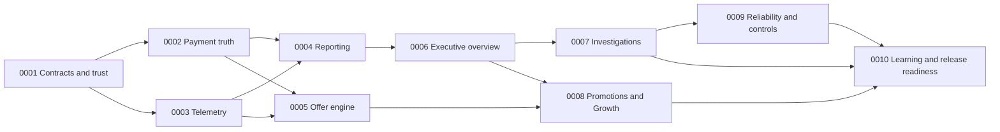

# Admin overhaul: orchestrator handoff

Status: planning complete; all implementation sprints planned, none started.
Prepared October 18, 2026 against local HEAD `f9f187e0498ffb6b586c9970aeda8aa3fcf92f96` plus the uncommitted overhaul specification. Re-inventory before building. This package authorizes no deployment or live financial/fulfillment operation by itself.

## Pyramid Index

- Goal and authority: [Source of truth](#source-of-truth).
- Delivery order and parallelism: [Sprint map](#sprint-map).
- Exact builder kickoff: [Paste-ready orchestrator prompt](#paste-ready-orchestrator-prompt).
- Scope/quality rules: [Execution contract](#execution-contract).
- Concrete tasks and checks: `SPRINT-0001.md` through `SPRINT-0010.md` in this directory.
- Coverage back to the source spec: [requirements map](ADMIN_OVERHAUL_REQUIREMENTS_MAP.md).
- Machine-readable status: [ledger.json](ledger.json).
- Planning provenance, source fingerprints and alternate-app handoff: [run index](../../.delivery/runs/20261018-admin-overhaul-plan/INDEX.md).

## Objective

Deliver a compact CEO portal that makes independent customer demand, conversion friction, acquisition economics, order exceptions and data quality inspectable and actionable. Strengthen discount codes into a first-class commercial workflow. Every summary must trace to evidence; every consequential control must expose its effect and preserve existing payment/fulfillment safeguards.

## Source of truth

Read these in order:

1. Repository [AGENTS.md](../../AGENTS.md), including any more specific instructions discovered at execution time.
2. [Canonical project brief](../CANONICAL_PROJECT_BRIEF.md) and [canonical product specifications](../CANONICAL_PRODUCT_SPECS.md).
3. [Full overhaul specification](../ADMIN_PORTAL_OVERHAUL_SPEC_2026-10-18.md), including the founder's instruction to preserve and strengthen codes.
4. This handoff and the active sprint document.
5. [Cleanup audit](../CODEBASE_CLEANUP_AUDIT_2026-10-16.md), as historical implementation context to revalidate, not authority to delete code or revive old rollout controls.

Older conversion-rescue claims and inferred abandonment figures are not verified baselines. Local source paths in sprint documents are entry points, not proof those files remain active. The implementation inventory controls which current consumers are edited.

## Sprint map

Sprints are bounded deliverable packages, not calendar promises. Re-estimate after inventory; split a package if the orchestrator cannot complete and verify it in one practical iteration. Preserve IDs and task traceability when splitting.

| ID | Deliverable | Dependencies | Exit evidence |
| --- | --- | --- | --- |
| [0001](SPRINT-0001.md) | Honest reporting, shared contracts, current-system inventory and safe validation harness | None | Verified/unknown states, financial alias closure, baseline/golden fixtures |
| [0002](SPRINT-0002.md) | Durable payment ledger, webhook inbox, order outbox and reconciliation | 0001 | Duplicate/out-of-order/failure tests; analytics outage preserves payment truth |
| [0003](SPRINT-0003.md) | Typed telemetry, session/journey identity and full payment diagnostics | 0001 | Active route matrix, privacy checks, storage/transport failure tests |
| [0004](SPRINT-0004.md) | Versioned reporting, observed funnels, dated spend and actual-cost coverage | 0002, 0003 | Golden cohort/financial parity; bounded queries; replay isolation |
| [0005](SPRINT-0005.md) | Versioned offers, transactional redemption and consistent auto-apply checkout | 0002, 0003 | Legacy-link parity; concurrent final-slot and stale-price tests |
| [0006](SPRINT-0006.md) | Compact executive shell, global scope and useful overview | 0004 | Desktop/mobile screenshots; metric-to-evidence navigation |
| [0007](SPRINT-0007.md) | Journeys, Orders, Economics and operational exception investigations | 0006 | Full pagination, paid-but-failed visibility, safe action parity |
| [0008](SPRINT-0008.md) | Promotions workspace, campaign Growth and measured recovery tools | 0004, 0005, 0006 | Offer lifecycle walkthrough; exposure-to-redemption/financial parity |
| [0009](SPRINT-0009.md) | Measured reliability, trace correlation, alerts and safe operational controls | 0002, 0003, 0007 | Isolated fault drills, safe pause/resume, audit and notification evidence |
| [0010](SPRINT-0010.md) | Decision log, exposure-based learning, migration rehearsal and release readiness | 0007, 0008, 0009 | Integrated evidence pack and deployment/rollback runbook; no invented lift |

Release slices: 0001 is an independently useful correction; 0002–0005 establish the business evidence; 0006–0008 deliver the operating portal and stronger discounts; 0009–0010 complete deeper control and learning. None is permission to auto-deploy. If external evidence is unavailable, ship honest unknown states and record narrowly blocked verification rather than fabricate a result or halt unrelated work.

## Execution contract

### Coordination and ownership

- One coordinator owns `ledger.json`, integration decisions and sprint acceptance. Workers update their assigned evidence files; they do not independently mark sprints complete.
- At most three implementation/review repair cycles before recording the unresolved condition and exact restart action; continue independent tasks. An external blocker is not evidence of completion.
- Parallel work is allowed only on independent task lanes after dependencies are satisfied. Use isolated worktrees and explicit file ownership when the chosen orchestrator supports them. Never overwrite another lane's modifications or unrelated user changes.
- Shared hotspots: `lib/types.ts`, `lib/telemetry-schema.ts`, `lib/order-processor.ts`, `lib/firebase-admin.ts`, active builder, checkout routes and `package.json`. Name one integration owner for each before dispatch. Prefer domain modules over enlarging these files.
- The reporting lane owns metric definitions; the telemetry lane implements evidence emission; the offer lane owns pricing/redemption contracts. Agree interface fixtures before parallel coding. The portal consumes APIs and never recalculates financial truth from recent-session rows.
- Recheck actual live-route imports before editing `TargetPurchaseExperience`, `app/preview/entry/client.tsx`, flags or experience routing. Do not resurrect retired builders or version switches. Emergency controls and stable experiment exposure are separate capabilities with concrete use cases.

### Shared contracts to freeze in 0001

1. Event v2 envelope, authority rules, ingestion responses, dedupe keys and safe properties.
2. Payment/capture/refund/dispute ledger, inbox/outbox and correlation identities.
3. Metric scope/status/coverage, eligible cohorts, maturity window, timezone and attribution version.
4. Offer version/quote/reservation/redemption lifecycle, legacy URL aliases and price snapshots.
5. Evidence/drilldown response, pagination/cursors and independent operational vs customer-reporting scope.

Persist these as typed code contracts and short documentation with fixtures. Breaking changes after freeze require a migration/compatibility note and notification to dependent lanes. Do not make UI wait for real provider access when contract fixtures can support it.

### Architecture choices and external facts

- Reuse Firebase for operational state. BigQuery is the proposed reporting backend; 0004 must verify feasibility, IAM, billing and bounded-query design and record the choice. The API contract is storage-independent. An emulator/local adapter can prove semantics; it cannot prove cloud performance or production ingestion.
- Start dated spend and invoice/fee inputs with authenticated validated imports. Ad API integrations are a follow-up unless access is already available and demonstrably worth the extra scope. No scalar undated spend as verified reporting.
- Existing Google Cloud reliability tooling is preferred before considering new vendors. Do not purchase tools, add third-party sensitive-data exports or provision new billable services merely to satisfy the plan.
- If supplier invoices, provider access or historical identities cannot be obtained, label values unavailable/unresolved. Read-only investigation may proceed where authorized; production record corrections require evidence, an audited mapping and explicit execution scope.
- Proposed defaults from the spec: 30-minute session inactivity boundary, 24-hour session conversion horizon, 7-day last-observable-non-direct attribution, America/Chicago UI timezone, one offer per order, refund does not automatically restore usage. Version these policies; do not describe them as measured business facts.
- Proposed retention windows are configuration prepared for review, not permission to activate destructive TTL deletion. Any infrastructure/deployment permissions must come from the execution environment/user separately.

### Non-goals and preserved behavior

Preserve guest purchase, custom-art choice, personal return identity, scenario entry, draft recovery, deferred address, existing valid codes/URL aliases, manual code entry, percentage/fixed/100%-off codes, comps, transactional email, existing order ownership/auth and fulfillment idempotency. Account/address-book/reminder behavior remains supported. Recipient-facing Aster & Blanche is preserved; touched sender-facing copy follows the canonical brief.

Do not implement broad storefront redesign, automatic marketing outreach, automatic ad bidding, a valuation-led growth engine, session replay, physical-delivery guarantees, new supplier claims or speculative integration frameworks. Live charges, refunds, billable mail, supplier assets, production flags, historical record migrations and deployment are outside planning authorization.

### Validation and evidence

- First audit scripts/tests for external effects. Existing milestone fulfillment tests/scripts must not be run as validation. `npm test`, `npm run build` and `npm run lint` are not assumed safe/working without inspecting their execution paths; the cleanup audit identified obsolete lint wiring and historical unsafe tests.
- Provide focused fake/emulator tests for financial truth, telemetry, offers, privacy and authorization. Deny real supplier/payment/email network calls in the automated test harness. Unknown financial data is exercised explicitly.
- Establish baseline TypeScript/build failures before edits and distinguish inherited failures from introduced ones. Run safe current typecheck/build and affected regression suites per sprint; record exact commands, revision, exit codes and environment. Do not fix unrelated application issues under this program without evidence they block it.
- Meaningful acceptance scenarios beat tests that merely assert file contents. Integration checks cover concurrent workers/transactions, retries, delayed/out-of-order events, state transitions and API/UI agreement.
- UI acceptance: 1440×900 at 100% zoom shows global scope, scorecard, entire funnel and at least three exception rows; validate 390px and 200% zoom, keyboard/focus, contrast and PII masking. Use synthetic screenshots, never unsanitized customer records.
- Every sprint writes `docs/sprints/evidence/SPRINT-NNNN/REPORT.md`: source/integration commit, changed scope, task/criterion matrix, commands/results, synthetic visual evidence, migration/rollback notes, limitations and next action. Missing cloud/device access must say not run, not passed.
- Mark complete only after all code acceptance criteria and a reviewer check pass. An unavailable external check remains a declared release gate, even if implementation is complete. The final integration report explicitly distinguishes built, locally verified, staging verified and production verified.

### Migration and rollout

Use additive schema changes and v2 shadow projections; legacy events stay legacy/partial and are not manufactured into new evidence. Replays write only analytics projections. Deploy consumers before switching readers. Backfill is idempotent, resumable and dry-run-first, with counts/checksums and redacted exceptions. Rollback switches the reader/UI to a known compatible version; it never deletes a capture, refund, redemption or fulfillment record. Reconcile a new/old reader difference rather than force numerical equality.

Stage new routes without disabling the old portal until parity and exception visibility are demonstrated. Preserve old admin URLs by documented redirects/aliases where necessary. Any actual deploy is a separate authorized action after the readiness packet is reviewable.

## Program acceptance and deferred work

All ten sprints passing means the application contains the designed capability and its evidence pack. It does not establish paid conversion improvement, verified Apple Pay in every browser, known supplier costs or a production rollout. Actual customer outcomes require subsequent observation.

Deferred and explicitly tracked: live ad API automation when access is absent; repeat-customer/LTV estimation until cohort maturity; real Apple Pay/browser walkthrough when available; supplier invoice confirmation; production data corrections/infra provisioning/TTL activation/deployment. Missing these inputs must not turn into fake metrics or hidden scope cuts.

## Paste-ready orchestrator prompt

> Implement the SendMyNotes admin overhaul from `docs/sprints/ADMIN_OVERHAUL_ORCHESTRATOR_HANDOFF.md`. Read its source-of-truth chain and `docs/sprints/ledger.json` first. Start with SPRINT-0001, re-inventory current routes and baseline checks, and preserve all unrelated changes. Execute the dependency graph; parallelize independent lanes only with isolated ownership and frozen contracts. Preserve and strengthen discount codes, including current codes/links, manual application, free/comp flows and campaign-aware auto-apply. Never use recent-session samples or browser confirmation events as financial truth. Use fake/emulator integrations with production fulfillment impossible. Record evidence per sprint and update the ledger only after acceptance and reviewer verification. Continue through independently executable work; record external unknowns precisely and keep affected data honest. Do not deploy, run live payments/refunds/mail, send outreach, modify production flags/data, activate destructive retention, purchase tools or provision billable infrastructure without separate authorization. Report built/local/staging/production verification distinctly. End with the evidence index, remaining release gates and next action.

## Review provenance

Prepared and locally reviewed in Codex; no independent agent or Antigravity review was performed. A manual alternate-plan/critique handoff exists in the run directory and is optional additional review, not a prerequisite invented to delay the requested handoff. Planning validation checks document/ledger consistency and coverage, not implementation correctness.
