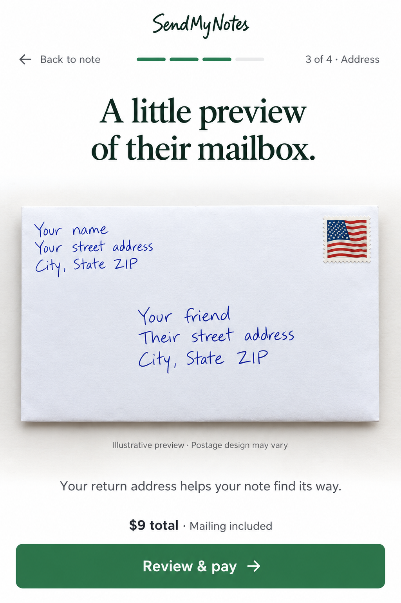

# SPRINT-0020: Integrate the photographic envelope preview

**Status: implemented; staging release verification in progress.** October 27, 2026.
**Design direction:** Founder endorsed the generated envelope mockup.
**Planning method:** Direct source review and single-author plan, continuing the founder-approved planning approach.
**Execution authorization:** The founder subsequently requested Luna agents to implement and push this sprint to staging. Three `gpt-6-luna` agents handled UI, assets and independent review; the coordinator integrated and verified the work. See [delivery evidence](evidence/SPRINT-0020/REPORT.md).

## Pyramid Index

- **L0:** Turn the approved photographic envelope concept into a fast, accessible live address preview inside the existing sending flow.
- **L1:** Reuse the extracted preview component; add realistic blank paper/postage assets; render actual addresses as live text; simplify the surrounding panel; verify mobile, international and deferred-address states.
- **L2:** [Baseline](#current-baseline), [Design](#design-contract), [Architecture](#architecture), [Tasks](#implementation-plan), [Acceptance](#definition-of-done), [Release](#release-and-rollback).

## Overview

Integrate the improved **envelope/address preview** shown below. “Letter preview” in this request refers to this envelope concept; redesigning the open card or interior message preview is outside this sprint.

Reference: [full concept and generation provenance](assets/SPRINT-0019/GENERATION.md). Follow [project instructions](../../AGENTS.md), [canonical brief](../CANONICAL_PROJECT_BRIEF.md) and [product specifications](../CANONICAL_PRODUCT_SPECS.md).

The result should feel like looking at the envelope the recipient will hold: white paper, subtle grain, natural light, a gentle contact shadow, crisp edges, and legible blue handwriting. This is an illustrative preview, not a verified print proof.

Preserve the existing brand header, progress/navigation, address inputs, pricing and primary action. The concept's script wordmark, large headline and hardcoded $9 example are not implementation requirements. No new navigation redesign, custom-art flow, admin work or international activation belongs here.

## Current baseline

Freshly fetched source on October 27:

| Reference | Source |
| --- | --- |
| Staging branch | `1aab44707b90e626bdb6698098d8e01a21642eaf` |
| Earlier storefront implementation within staging | `222f62b` — SPRINT-0019 Track A |
| Main branch | `5d008dd82f078002926de7e03a87a34e89ae1741` |

These are **Git source observations**, not a fresh confirmation of hosted deployment. Refresh serving builds before implementation/release. The original working directory remains dirty and behind the remote; preserve it.

What already exists in staging:

- `components/flow/EnvelopePreview.tsx` accepts sender, recipient, optional font class, deferred-address state, international state and country label.
- It already uses blue text, a quieter envelope silhouette, an illustrative-preview caption and no fake barcode.
- `Step3EnvelopeAddressing.tsx` mounts it through `LiveEnvelopeCard`.
- The navigation and note-editor changes are present in the Track A source; do not reimplement them.

Remaining gap:

- The envelope is a flat cream CSS rectangle with a gradient imitation stamp, rather than the photographed material in the concept.
- The parent still wraps it in a rounded cream panel, “Live Envelope Preview” header and ink/stamp badge.
- Fixed/minimum address widths and `overflow-hidden` need layout verification with long addresses; source inspection alone does not establish actual clipping.
- `countryName` is accepted by the wrapper but is not supplied by its mounted call. Wire the existing destination catalog's display name through.
- Existing tests exercise rendered text and domestic/international markers; they do not prove visual fidelity or mobile readability.

SPRINT-0019 Track A (source `222f62b`) remains historical context. This sprint owns its remaining photographic-envelope polish; it does not declare the other sprint fully accepted. No semantic index or chapter is configured.

## Use cases

1. A sender edits either address and immediately sees the exact values on a realistic envelope.
2. A sender using a phone can read the recipient block without zooming and still reach the address form easily.
3. A long name, apartment line or international address remains complete without overlapping postage or being silently shortened.
4. A deferred-address sender sees an explicitly incomplete preview.
5. If the texture or handwriting font cannot load, the preview stays legible and the form still works.

## Design contract

### Envelope and surrounding UI

Use the existing page heading “Where should we mail it?” and a small **Your envelope** label if needed. Remove the nested cream card, dividing rule and “Real Blue Ink / USPS Forever Stamp” badge around the preview. Show one envelope and one caption:

**Illustrative preview · Postage design may vary.**

Replace the large return-address callout with one restrained sentence, preserving the personal-return-address requirement: **Your return address appears on the envelope.** Keep substantive validation and address-deferral guidance.

At desktop widths, retain the preview beside the address form. On mobile, keep a compact full-width preview in the address flow, without the mockup's oversized heading or excessive vertical whitespace. Do not duplicate it elsewhere in checkout or move/rebuild the form in this sprint.

### Photographic materials

Create a reusable **blank** envelope artwork asset from the approved direction: straight-on white paper, fine restrained grain, near-square corners and neutral lighting. Separate surface and shadow if that improves responsive behavior. Avoid exaggerating paper thickness, embossing or texture.

Use the built-in image-generation tool for creating/editing the raster assets during implementation. Feed it the already sanitized concept rather than the private original where possible. Do not ship the full screenshot with baked-in text or remove its writing by covering it with white rectangles.

Create a separate small illustrative domestic stamp asset matching the concept's realism. Do not retain the CSS gradient stamp or hardcode “2026,” a denomination or a claim of an exact stamp. International presentation uses a neutral postage treatment, not a domestic Forever-stamp promise; do not add an unsupported “AIRMAIL” service claim.

Select the master envelope aspect ratio from the approved visual asset and record it with its intrinsic dimensions. Keep it consistent at normal sizes rather than independently stretching width/height. Do not confuse the card's verified 17:22 front ratio with envelope geometry or call an optical ratio a supplier measurement.

No barcode, cancellation mark, sender-local postmark or personal details belong in the reusable artwork.

### Live blue handwriting

Render addresses as ordinary selectable DOM text over the paper. Position sender top-left, postage top-right, and recipient below center with a left-aligned address block. Give each region reserved space.

Use the bundled handwriting fonts; start visual comparison with `hwDavid.ttf` / `font-hwDavid`, which is the existing default and closest stated direction to casual upright print. Compare a rendered sample against the concept before locking size/weight/spacing. Do not introduce an unlicensed font or artificially bold the handwriting to compensate for poor sizing.

Preserve the existing `fontClass` API and supported styles for compatibility. Verify every style currently passed by the parent. The preview is illustrative; do not assert that an interior font selection guarantees exact physical envelope lettering.

At 390px, aim for recipient text around 16–18 CSS px and sender text around 12–14 CSS px, adjusted for the font's real glyph size. The mockup is the visual target; readability takes precedence over pixel-perfect positioning.

Place apartment/unit text on its own line where present. Preserve Unicode, punctuation, leading-zero postal codes and every entered character. Keep country names readable using the existing catalog; fall back to the supplied code only when a name is unavailable.

Avoid fixed minimum widths that force overflow. Let address blocks wrap within reserved regions. At long content or enlarged text, expand the layout vertically with a non-distorting paper treatment rather than clipping, ellipsizing or shrinking text indefinitely. Do not hide overflow as the fix for an address that does not fit.

### Incomplete, deferred and international states

- Empty fields use neutral generic placeholders, clearly identifiable as examples; do not substitute the founder's photo data.
- Partially filled addresses preserve entered values and do not imply they are delivery-ready.
- Deferred recipients keep the name and show **Street address to be added later** instead of placeholder mailing lines. Existing eligibility rules stay unchanged.
- Resolve the international country label from the already loaded mailing-options catalog and pass it through the wrapper.
- Keep country-specific missing-region/postal-code behavior and US personal sender rules. Preview formatting must not become a new address validator.
- Totals and checkout stay outside the preview component. Do not bake $9, $14 or discount values into artwork or this visual component.

## Architecture

Enhance the existing `EnvelopePreview`; do not build a second preview system or another draft store.

Keep the component pure and driven by existing props. It must not fetch, generate images, log address content, update draft state, validate shipping eligibility or call checkout. Typing must not trigger a provider request. No customer address is ever sent to an image generator.

Use local static assets under a small dedicated directory such as `public/images/envelope-preview/`. Load optimized WebP/AVIF through the existing image approach, with fixed intrinsic dimensions/reserved layout space to prevent shifting. Do not add a rendering package or canvas dependency. Set a target of **150 KB or less combined compressed paper and stamp assets**; if quality requires more, record the size and compare visual/loading impact before accepting the exception.

If the image fails, a CSS white surface and border remain behind the live addresses. If fonts fail or load late, use a legible fallback without overlapping regions. Give decorative textures/stamps empty alternative text; expose sender and recipient labels and their text once in the accessibility tree. Do not announce every keystroke through an assertive live region.

Keep the full-screen concept in documentation. Ship only visually checked, sanitized production assets, stripped of unnecessary metadata. Preserve the private original unchanged.

## Implementation plan

| Task | Work | Files / proof |
| --- | --- | --- |
| T01 — Baseline and scope | Start from the current staging source containing the extracted component; inspect local instructions, current consumers and concurrent work. Capture existing 390px/desktop appearance with fictional addresses. | Baseline SHA, screenshots, current prop/country/font contracts; isolated checkout. |
| T02 — Production assets | Generate the blank paper and separate postage visual, optimize exports, check privacy, material restraint, edges and transparency at full resolution. | `public/images/envelope-preview/*`; provenance, dimensions, byte sizes and visual review in sprint evidence. |
| T03 — Live composition | Update layout, material layers, blue text, wrapping, sender/recipient regions and graceful asset/font fallbacks. | `components/flow/EnvelopePreview.tsx`; scoped CSS only if useful. |
| T04 — Parent integration | Simplify `LiveEnvelopeCard`, remove old badge/card chrome and large return-address callout, pass the resolved country name. Preserve form state and current desktop/mobile structure. | `components/v3/Step3EnvelopeAddressing.tsx`; no checkout/draft/navigation refactor. |
| T05 — Acceptance | Add focused component/interaction cases to existing tests or one envelope-specific suite. Run current SPRINT-0019 and relevant international layout regressions, typecheck/build. Review actual mobile/desktop renders against the concept. | Evidence under `docs/sprints/evidence/SPRINT-0020/`, including captures and honest limitations. |
| T06 — Staging delivery | When execution is authorized, integrate only this change and verify the exact hosted staging build and real flow with fictional data. | Staging URL/build/SHA, responsive checks and compatible rollback target. |

Expected scope: one existing preview component, its parent integration, two small assets, focused validation and documentation. Extend further only for a concrete dependency discovered during implementation.

## Definition of Done

- [x] The mounted address-step preview visibly matches the approved direction: photographic white paper, fine grain, gentle shadow, crisp edges, realistic illustrative postage and legible blue handwriting.
- [x] The gradient stamp, old nested rounded preview panel and redundant ink/stamp badge are gone.
- [x] Sender/recipient edits update live text exactly; no customer content is baked into or sent for image generation.
- [x] Domestic, international, empty, partial and deferred cases work; full country names arrive through the real parent call.
- [ ] Long names/streets, apartment lines, long unbroken input and Unicode remain visible at 320px, 390px, 768px and desktop widths, and at 200% text/zoom. No horizontal page overflow, stamp collisions or hidden address text.
- [ ] All supported handwriting classes, slow/failed font load and failed image load retain a usable preview.
- [ ] Keyboard focus/order and screen-reader address labels work; decorative imagery is not redundantly read. The existing form and primary button remain usable with the mobile keyboard and safe-area inset.
- [x] Review on iOS Safari and a desktop browser; explicitly record any unavailable device coverage. Static markup tests do not substitute for visual checks.
- [x] Existing custom cover, note, Back/Forward, country selection, discount and deferred-address behavior survive the change. Test narrowly for regressions, without reopening those designs.
- [x] Asset dimensions/size and sanitized visual inspection are recorded. No original personal information, identifying barcode or photo metadata enters public files.
- [x] Runtime input edits initiate no image-generation, payment, order, email or fulfillment requests attributable to this component. Automated checks use fixtures/fakes.
- [ ] Typecheck, build and relevant existing suites pass; hosted acceptance is tied to the exact deployed candidate when a release is authorized.

**Acceptance notes:** Local rendering, failure fallbacks and doubled address text pass. Full-browser zoom, real slow-font timing, VoiceOver and physical iOS keyboard/safe-area checks remain unverified; see the delivery report. Hosted verification is pending the authorized staging rollout.

## Risks and mitigations

**Looks realistic only in a static mockup:** Use actual DOM addresses over the final assets and compare mounted screenshots with the concept, including long-content states.

**Inherited wrapper defeats the design:** Treat parent cleanup as required work; swapping only the rectangle color or paper background does not complete the sprint.

**Address clipping under responsive sizing:** Use explicit layout regions and bounded wrapping, then visually verify. Allow extra height at accessibility extremes rather than losing text.

**Image or font cost slows the flow:** Small static assets, reserved geometry and readable fallbacks; no runtime generation or new framework.

**Branch/status confusion:** Staging source already includes Track A, while the old local ledger still describes SPRINT-0019 as planned. Do not erase that discrepancy by declaring acceptance. Pin current source, refresh hosting at execution and preserve other active work.

**Manufacturing overclaim:** Retain the illustrative caption, avoid exact stamp/stock guarantees, and do not treat a generated texture as new supplier evidence.

## Dependencies and open decisions

The founder has endorsed the visual direction; no additional product question blocks this plan. Final blank-asset quality and typography are implementation choices to resolve through rendered comparison.

Reuse SPRINT-0019's extracted component and existing navigation. Do not require international activation or promotion of the wider admin backlog. The existing private photo is optional source material, not a required public asset.

## Release and rollback

Execution and staging delivery are now explicitly authorized. Production promotion remains a separately scoped release decision. Refresh remote refs, serving build, environment and concurrent rollout ownership before execution. Do not merge the whole staging branch to deliver this preview.

Ship backwards-compatible component changes and versioned static assets, with no persistence/schema migration. Preserve prior assets until rollback is no longer needed; old tabs must remain usable. Revert the scoped UI/asset change or use the current compatible prior build if visual or form regressions appear.

Record exact source, deployed build, asset checks, screenshots, test results and any remaining device limitation. No real payment, supplier submission or physical mailing is needed for acceptance.
