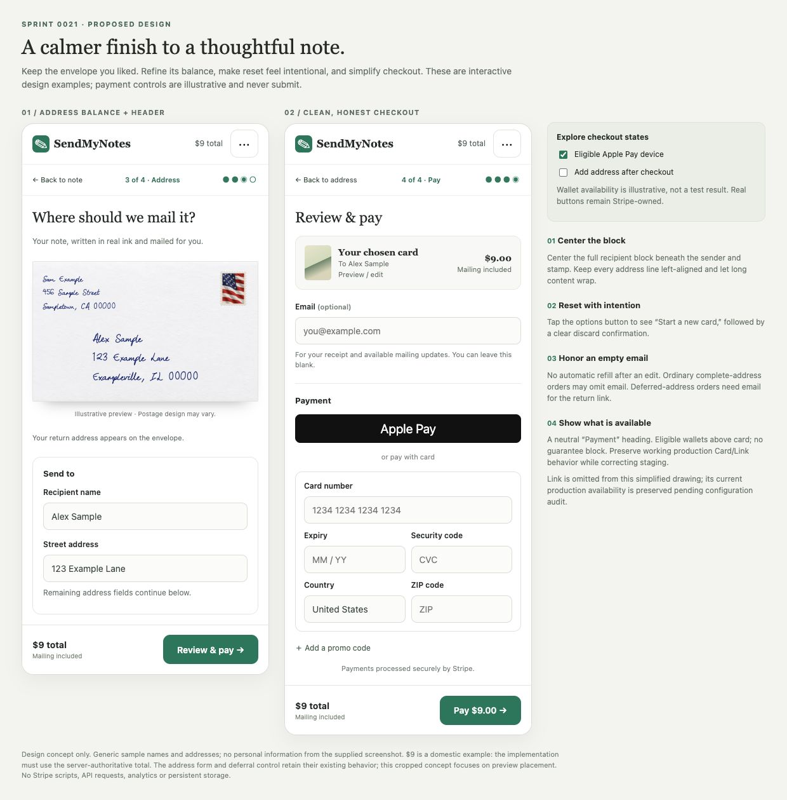

# SPRINT-0021: Finish the sending flow and align staging payments

**Status: implemented and reviewed; local checks passed; staging deployment pending.** October 27, 2026.
**Planning method:** Direct source review and single-author synthesis, continuing the founder-approved planning exception. No independent planning review is claimed.

## Pyramid Index

- **L0:** Refine envelope alignment and reset controls, make email behavior intentional, remove checkout guarantee clutter, and diagnose staging payment differences without disturbing production.
- **L1:** Small visual refinements; explicit contact-email rules across card/wallet/free orders; environment-specific Stripe parity investigation; scoped staging acceptance and production protection.
- **L2:** [Findings](#verified-findings-and-unknowns), [Design](#design-plan), [Email contract](#email-contract), [Payments](#staging-payment-parity), [Tasks](#implementation-plan), [Acceptance](#definition-of-done).

## Overview

The founder likes the photographic envelope but finds the recipient address slightly off-center. The header's wrapping, underlined “Start over” looks unfinished. On staging, Apple Pay is absent while Bank and Klarna appear; the founder reports production displays correctly. Clearing the email field immediately restores it. The checkout satisfaction-guarantee section should be removed.

Keep the existing four-step journey, cover/message preservation, real-paper assets, personal return address, server-derived totals, and working production payment behavior. This is a finishing sprint, not a new checkout architecture or a Stripe SDK migration.

Follow [project instructions](../../AGENTS.md), [canonical brief](../CANONICAL_PROJECT_BRIEF.md), and [product specifications](../CANONICAL_PRODUCT_SPECS.md). “Production looks correct” is founder-reported display evidence; it does not establish a completed Apple Pay transaction. The canonical Apple Pay end-to-end status remains unverified until a specific test proves it.

## Mockups

- [Interactive concept](assets/SPRINT-0021/checkout-polish.html): try the options menu, reset confirmation, eligible-wallet toggle, and deferred-address email toggle.
- [Options menu](assets/SPRINT-0021/options-menu.jpg) and [discard confirmation](assets/SPRINT-0021/reset-confirmation.jpg).
- [Card-only checkout with required deferred-address email](assets/SPRINT-0021/checkout-deferred-card-only.jpg).

These are design examples, not working Stripe controls or payment evidence. They use generic fictional data and the approved SPRINT-0020 assets. The $9 total is a domestic example. The simplified card thumbnail and partial address form are illustrative; retain the real cover and complete existing form in implementation. Link is omitted from the drawing for clarity, not approved for removal. The real brand mark and Stripe-owned wallet buttons remain authoritative.

## Verified findings and unknowns

Remote branch tips checked October 27: staging `c8cc214100dc5f0184df9d1f0131a3c108e94e9e`; main `5d008dd82f078002926de7e03a87a34e89ae1741`. Source review used the isolated SPRINT-0020 clone at the staging commit. The original working directory is older and dirty; preserve it. These refreshed Git observations are not a new hosting inspection. SPRINT-0020's release report records the prior exact serving-build verification.

| Concern | Verified source / evidence | Implication |
| --- | --- | --- |
| Recipient alignment | `EnvelopePreview.tsx` uses `ml-[20%]`, desktop `ml-[22%]` and `sm:w-[72%]`. The glyph block is left-aligned inside that offset region. | Text length changes its perceived center. Center the bounded content block instead of adding another guessed margin. |
| Start over | `FlowHeader.tsx` puts an underlined small button between the logo and a long reassurance pill, without a no-wrap constraint. A discard confirmation already exists. | Fix hierarchy and spacing while retaining intentional reset confirmation. |
| Email returns after deletion | `app/preview/entry/client.tsx:238` refills from `user.email` whenever `customerEmail` is empty. | Confirmed state-management cause; not evidence of browser autofill or Stripe overwriting the field. |
| Secondary email retention | `Step4ReviewAndPayment.tsx` has a similar truthiness-based `committedEmail` effect. Confirm-order, fulfillment, free-order and webhook paths also fall back to earlier email values with `\|\|`. | A UI-only fix is insufficient if “no email” becomes a supported checkout choice. |
| Current email requirement | The email input is `required`; `handleSubmit` rejects blank email before paid/free/mock submission. Express Checkout has a separate confirmation handler. | The current card/free UI cannot submit without email. Define one policy for every payment path. |
| Stripe methods | Both reviewed main and staging versions of `lib/stripe.ts` request `payment_method_types: ["card", "link"]`. | Bank/Klarna in the screenshot is not explained by this source alone. Inspect the actual intent, account/mode and rendering path before changing configuration. |
| Misleading payment heading | The heading always says “Apple Pay, Google Pay & Card”; readiness only controls the express-button container. | Use a neutral heading that remains truthful when only card or Link is available. |
| Guarantee duplicated | Desktop has “Guaranteed / Real pen or free re-mail”; mobile has “100% Satisfaction Guarantee / Real ballpoint inking or free re-mail.” | Remove both, and collapse the empty layout space. |
| Confirmation assumes email | `app/order/[id]/page.tsx` can display `Receipt Sent: Delivered` when no email exists. | Update no-email success copy and notification/reminder handling together. |

No Stripe Dashboard, account-domain registration, current PaymentIntent or private configuration was inspected in this planning turn. Missing staging domain registration, account/mode mismatch, an older saved intent, Link funding options, and a different creation/render path are hypotheses—not established causes. No payment or fulfillment was attempted.

Recent context: SPRINT-0018 established guarded staging delivery; SPRINT-0019 added navigation/cover preservation; SPRINT-0020 added the photographic envelope. No semantic index or chapter is configured. See [planning evidence](evidence/SPRINT-0021/FINDINGS.md).

## Use cases

1. A sender sees a balanced envelope with short or long address lines.
2. A sender can intentionally discard a draft without a prominent, cramped reset link competing with the brand.
3. A signed-in sender clears or replaces their email and the form respects that edit through navigation and checkout refreshes.
4. A sender with complete addresses can pay without a receipt email; a sender deferring the recipient address has a reliable emailed return link.
5. An eligible iPhone displays the intended wallet on staging, while unsupported devices retain a clear card fallback.

## Design plan

### 1. Center the recipient block

Keep the current paper, stamp, blue handwriting, sender region and illustrative caption. Replace the percentage left margins with a full-width lower layout row that centers a content-sized address block. Start with `width: max-content; max-width: 100%`, `justify-self: center`, and left-aligned lines. Constrain it inside the envelope's padded content area; no absolute positioning or negative offsets.

Measure the block's horizontal center against the usable envelope center. Normal three-line addresses should be within roughly 4 CSS pixels of center; judge the actual glyphs visually as well. Keep the recipient in the lower central area, below reserved sender/postage space. Long lines, apartment lines, international destinations and doubled text may grow vertically and wrap. Do not center individual lines, shrink text to fit, or reintroduce clipping. This is optical UI positioning, not a claim about physical printing accuracy.

### 2. Replace the exposed reset link

Use a quiet 44 × 44px outlined options button at the trailing edge of the header, with accessible name **Card options**. Its menu contains **Start a new card**. Keep the brand on one line. Replace the long header reassurance pill with a compact, one-line total derived from the existing server-authoritative amount; retain mailing/price details in the established summary. Never introduce another fixed $9 source or mislabel a discounted/international total.

Confirmation: **Start a new card?** → “This will discard your selected cover, message and address details.” Actions: **Keep editing** (initial focus) and **Discard & start new**. Reuse an accessible existing dialog/menu primitive where suitable. Escape, outside click, keyboard navigation, focus trapping and return focus must work. Menu opening and cancellation do not mutate drafts. Reset remains unavailable during an in-flight payment or after payment capture; visual relocation must not introduce a way to abandon payment reconciliation.

### 3. Simplify checkout reassurance

Remove both satisfaction/real-pen-or-free-remail blocks. Use one restrained line, **Payments processed securely by Stripe**, rather than duplicate large security tiles and unsupported encryption-strength marketing. Keep real payment errors and price changes visible.

Use **Payment** as the section heading. Render eligible express methods above the card element; show the divider only when an express method is actually available. Keep Stripe's native buttons and brand treatment. A drawing of Apple Pay is not a workaround for failed wallet readiness. Preserve existing Link behavior unless the configuration audit identifies a separate product decision.

This removes promotional checkout blocks; it does not silently rewrite the return-policy page or change actual refund obligations. Any contradictory policy copy discovered should be recorded separately.

## Email contract

**Answer to the founder's question:** Stripe's PaymentIntent `receipt_email` is optional. A basic card payment does not inherently require our separate receipt-email field. Individual payment methods can still collect information they need. Our current frontend imposes the mandatory email rule. [Stripe PaymentIntent reference](https://docs.stripe.com/api/payment_intents/create), [Payment Element field rules](https://docs.stripe.com/js/elements_object/create_payment_element).

Recommended product behavior:

| Order/contact state | Behavior and copy |
| --- | --- |
| Complete recipient and return addresses; email blank | Permit checkout. Label **Email (optional)**. Explain: “For your receipt and available mailing updates. You can leave this blank.” |
| Email supplied | Validate a normalized address before submission. Use it for the stated transactional purpose; do not add marketing consent. |
| Recipient address deferred | Require email before payment can be confirmed. Label **Email (required to add the address later)**. Explain the secure return link. |
| Email deliberately cleared | Keep it empty. Do not restore the account email, prior order email or wallet receipt email into this field. |
| Zero-cost order | Apply the same complete-address/deferred-address policy; free checkout is not an exception. |
| Wallet supplies billing contact | Keep payment-method billing requirements separate from our optional receipt preference. Do not silently reverse an explicit receipt-email omission. |

Implementation requirements:

- Prefill authenticated email once per new draft, only while contact state is untouched. Late auth loading must not overwrite typing or a deliberate clear. Prefill is a suggestion, not synchronization with the account profile.
- Represent **untouched**, **provided**, and **deliberately omitted** explicitly. Preserve that choice through Pay → Address → Pay, retry, discount changes and checkout remounts. Do not change the user's authentication profile or shared saved address book.
- Replace the `committedEmail` truthiness behavior with a commit/snapshot model that respects an empty value. Avoid remounting Stripe Elements or recreating PaymentIntents on each keystroke.
- Before card or wallet confirmation, validate the same contact rules and persist the chosen contact state on the pending order through a capability/ownership-checked path. Fail visibly and keep the draft if that update fails. Free-order and server confirmation paths use the same rules. Decide whether to extend an existing authenticated pending-order path or add a narrowly scoped contact-update route after inspecting available contracts.
- Audit existing-intent receipt email too: omitting a new `receipt_email` parameter does not prove an older value was cleared. Use supported Stripe update semantics, verify the result, and prevent webhook/confirm-order races from restoring stale contact data. Old orders without an explicit choice retain legacy behavior.
- Prevent blank-email deferred orders through all normal payment entry points. If an old or bypassed client reaches a paid deferred order without contact, preserve the paid state and secure recovery link; do not invent a receipt, charge again, or dispatch an incomplete address. This is an operational hold/recovery case.
- No-email success shows an order reference and secure order-status access, with **No email receipt requested**. Never show “Receipt sent” without send evidence. Make the status link recoverable from the confirmation screen and existing browser capability storage; do not expose it in analytics or logs. Explain that there will be no emailed updates. Hide email reminders or ask for an email only when the sender explicitly opts into one.

Making email optional depends on these server and confirmation changes. Ship the immediate refill fix independently if the wider no-email contract needs more time; do not simply remove `required` and declare the work done.

## Staging payment parity

### Audit first

Record a small comparison matrix for staging and production: exact serving SHA/build; Stripe account identity (redacted), mode and matching publishable/secret key provenance; actual selected PaymentIntent's method types/configuration; hostname registration; SDK/API versions; supported browser/device and wallet readiness. Inspect configuration read-only. Do not list unrelated customers or dump keys, client secrets, email addresses or card data into evidence.

For the screenshot discrepancy, reproduce from a fresh checkout in the normal flow. Determine whether Bank/Klarna come from the underlying intent, another route, cached checkout state, or Link-related presentation. `paymentMethodOrder` controls ordering, not the allowed set; it is not a method filter. [Stripe ordering documentation](https://docs.stripe.com/js/elements_object/create_payment_element).

### Correct only the identified staging difference

- Check registration of the exact staging hostname in the correct Stripe test environment/account, separately from production. Check mode/key pairing and replace reliance on the hardcoded test publishable-key fallback with explicit matched configuration if it is involved.
- Compare native Safari on an eligible iPhone with Stripe's wallet-rendering demo on the same device. Record `availablePaymentMethods.applePay`, not merely “some wallet available.” Also check Google Pay in its supported environment and card-only fallback. Wallet visibility depends on eligibility and registration; it is not guaranteed in every browser. [Stripe wallet testing](https://docs.stripe.com/testing/wallets?ui=express-checkout-element), [domain registration](https://docs.stripe.com/payments/payment-methods/pmd-registration?dashboard-or-api=dashboard).
- Preserve the existing Card/Link method restriction and production wallet behavior unless evidence shows that a specific scoped change is necessary. Remove unwanted Bank/Klarna through the actual intent/configuration source, not CSS hiding or ordering tricks. If dynamic methods are genuinely needed, choose an explicitly scoped configuration rather than editing a shared default. [Stripe configurations](https://docs.stripe.com/payments/payment-method-configurations).
- Never copy live keys into staging, enable live charges there, or alter production's working Dashboard configuration to make screenshots match. Keep review-only, email, supplier and physical-mail protections.
- Do not upgrade Stripe packages or migrate PaymentIntents to Checkout Sessions as an incidental fix. Current dependencies include Stripe JS 5.x / React Stripe 3.x / server Stripe 17.x and API version `2025-01-27.acacia`; verify proposed options against the installed types and API rather than assuming the latest documentation is directly compatible.

Target parity means the same intended method policy on equivalent eligible devices with different safe environment credentials—not identical buttons on every device. Production deployment is a separate decision after the exact release candidate and environment comparison are reviewed.

## Implementation plan

| Task | Work and likely files | Acceptance evidence |
| --- | --- | --- |
| T01 — Pin baseline | Fresh refs/serving builds; capture UI with synthetic contact data; inspect actual Stripe environment and intent. | Redacted parity matrix; explicitly separate measured differences from hypotheses. |
| T02 — Visual polish | `components/flow/EnvelopePreview.tsx`, `FlowHeader.tsx`, relevant header props and existing dialog/menu primitives. | 320/390/768/desktop captures; centering measurements; keyboard reset checks; no data loss on cancel. |
| T03 — Remove clutter | `components/v3/Step4ReviewAndPayment.tsx`: both guarantee variants, payment heading and quiet security line. | Mobile/desktop, wallet/card-only, loading/error and promo layouts; no empty panels. |
| T04 — Editable email | `app/preview/entry/client.tsx`, Step4 contact state, relevant draft state. | Signed-in/guest, late auth, delete-to-empty, replacement, navigation/remount/promo refresh tests. |
| T05 — Optional-email contract | Contact commit path; `create-intent`, `confirm-order`, `complete-free-order`; `lib/order-processor.ts`, Stripe webhook, order types and `app/order/[id]/page.tsx`; email helpers as needed. | Card/wallet/free policy matrix, explicit omission survives server fallback and webhook ordering; truthful no-email confirmation. |
| T06 — Staging parity | Only the audited domain/key/intent/configuration differences; Step4 readiness telemetry as needed. | Eligible-device Apple Pay visibility; no unwanted methods; matched test account; production fingerprints unchanged. |
| T07 — Review/release | Focused tests, typecheck/build, independent code review on execution; isolated staging deployment and exact-build acceptance when authorized. | Staging SHA/READY/SUCCEEDED/traffic, screenshots, regression results, rollback record and remaining device limits. |

Suggested order: baseline first; visual and email-state work can proceed separately from the payment investigation. T05 depends on the contact policy and T04; T06 changes require T01 evidence. UI improvements need not wait for an unavailable physical wallet device, but wallet parity must remain explicitly unaccepted until tested. No estimated conversion uplift is asserted.

## Definition of Done

- [ ] Normal recipient blocks are centered visually and geometrically; long/Unicode/apartment/deferred/international states wrap without stamp collision at 320, 390, 768 and desktop widths and enlarged text.
- [ ] Header does not wrap the brand or reset action; total follows the real quote. Menu/dialog work with keyboard, Escape and assistive labels; cancel preserves custom cover, note, addresses and contact choice.
- [ ] Both checkout guarantee blocks are gone; one truthful security line and a neutral payment heading remain.
- [ ] Clearing email stays cleared across the full checkout lifecycle. Optional means optional for complete-address card/wallet/free orders, with consistent validation of nonempty values.
- [ ] Deferred-address email requirement is consistent; no loss of a paid order or recovery access when a late/malformed request needs a hold.
- [ ] Server, stored order, Stripe receipt data and webhook handling honor explicit omission; no stale-address email is sent. Retries remain idempotent and preserve payment/capture guards.
- [ ] No-email confirmation/status and reminder behavior are truthful; no automatic marketing enrollment.
- [ ] Staging's actual method policy is diagnosed and corrected; eligible iOS Apple Pay and supported Google Pay rendering are recorded separately from transaction success. Card-only fallback remains available.
- [ ] Production's keys, domain registrations, method policy, webhooks, routing and serving build remain unchanged during staging work. Review guards remain active.
- [ ] Extend relevant payment-parent, payment/discount-browser, email, payment-mode-safety, envelope and SPRINT-0019 tests; run typecheck/build with fixtures and provider calls blocked. Test focus and actual responsive rendering, not just source-string assertions.
- [ ] An authorized release has exact hosting evidence. No live payment/fulfillment test is inferred from a rendered wallet button or a mockup; any unavailable device coverage is explicitly left open.

## Risks, dependencies and release boundaries

The highest risk is stale email surviving on an existing order or PaymentIntent and being restored by a webhook. The next is “fixing staging” by changing a shared live Stripe setting. Treat both as explicit review gates. Keep the UI polish separable from provider configuration so each can be rolled back independently.

No destructive schema migration is needed: additive contact-choice metadata should preserve old-order compatibility. Revert scoped component/state changes independently of environment configuration; record previous staging settings before changing them. Preserve the original dirty checkout and use a current isolated source checkout for implementation.

For a later production release, review the candidate's full diff and prerequisite dependencies. Do not merge the entire staging branch just to ship this polish, and do not blindly cherry-pick code that relies on staging-only APIs. Production configuration changes require their own concrete, narrowly scoped decision.

## Decisions for approval

Recommended: centered left-aligned recipient block; reset in an options menu; optional email for complete-address orders; required email for deferred-address orders; remove checkout guarantee marketing; diagnose and correct staging parity while preserving production Card/Link/wallet behavior. No additional question blocks the plan. The root cause of the staging provider discrepancy and the precise pending-order contact-update implementation remain execution findings.

## Execution update — October 27

Luna agents implemented and independently reviewed the sprint. All 16 focused suites, typecheck, build and scoped browser fixtures pass. The founder clarified that production’s current user-facing Stripe setup is the reference: retain Card/Link and pricing behavior. The exact staging hostname is now registered for test-mode wallets, and a synthetic unpaid intent verified the test key pair. Bank/Klarna are Link funding options in the staging UI; their visual parity and eligible-device Apple Pay acceptance remain open. See the [execution report](evidence/SPRINT-0021/REPORT.md).
