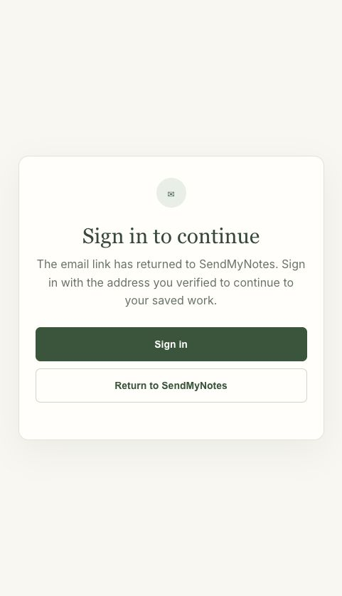

# Sprint 0025 staging review

Verified November 1, 2026.

- Review: https://staging.sendmynotes.com/account
- Application candidate: `8373cb3c529ae726ca8c22ee5976364d311e4b35`
- App Hosting build: `build-2026-11-01-003`; READY, successful rollout, 100% of staging traffic.
- Draft PR: https://github.com/zbrustkern/sendmynotes/pull/4
- Production still serves `a298a19` / `build-2026-10-30-005`. Its application traffic, runtime configuration and Firestore rules are unchanged. Additive resource provisioning is recorded separately.
- All 21 manifest indexes are READY in both projects. Both dedicated private buckets have uniform access and public-access prevention; runtime object permissions were inspected.
- Staging review-only flags and supplier test mode are true. Reminder delivery is explicitly false. No new reminder job was activated, and no real payments, supplier orders or emails were used for validation.

## Checks and observed limits

All 14 account suites, nine payment/recovery regression suites, TypeScript and the production build passed after the history correction. Earlier targeted Studio, operations, privacy, free-order, quote and security checks also passed; the final history correction changes only account list handling/overview and its tests. See `checks/results.json` and local logs.

Twenty-one hosted smoke checks pass: eight page shells, ten private API authentication/cache checks, and three cron authentication checks. Cloud assertions verify the exact source, build, traffic, safety flags, both index manifests and unchanged production application.

The founder performed legitimate sign-in and reported that the account looked good but empty Card history crashed. The cause was a double-wrapped list response. The deployed fix returns the correct flat pagination response and turns malformed list responses into recoverable errors. A new regression covers empty/populated/paged history plus nearest dates beyond the first 50 saved occasions. Founder retest after refreshing the deployed fix remains pending; local contract checks are not represented as a completed signed-in browser test.

The agent browser verified the public email-verification continuation while signed out. It prompts sign-in and does not falsely claim successful verification. No real verification email was sent during this check.

Broader two-user ownership, real private-storage fixtures, responsive/keyboard acceptance, cleanup dry-run/scheduling, manual privacy processing rehearsal, and signing-key migration remain in RELEASE-GATES.md. This is a staging review candidate, not a production approval.

## Manual privacy decision

Keep manual requests for this release. Zeke is the initial operator. Settings clearly labels “Request account deletion” and explains that submission does not immediately delete the account. The admin dashboard is the active review surface; privacy@sendmynotes.com routing has not been configured or verified. No automated erasure is claimed.
